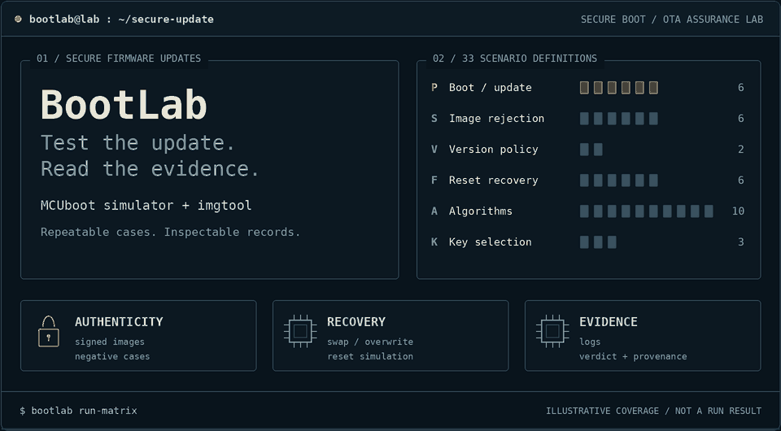
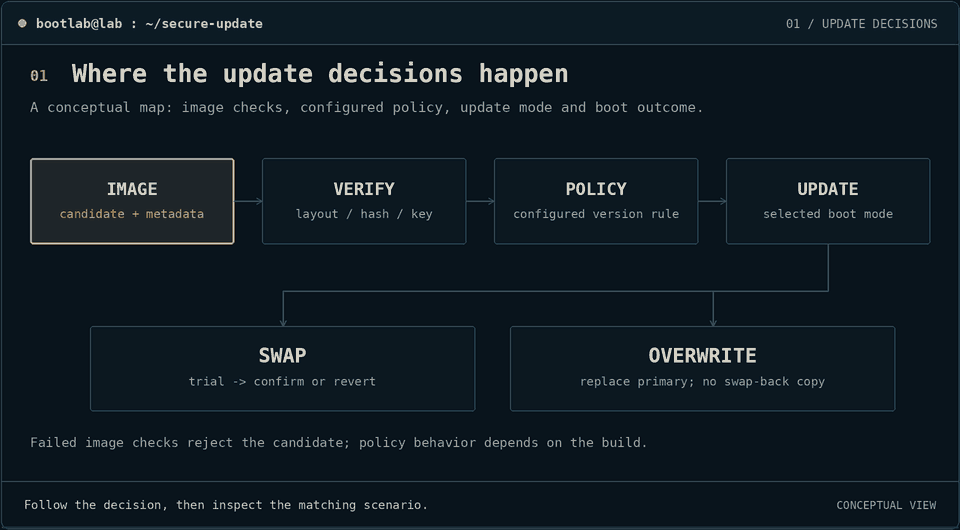
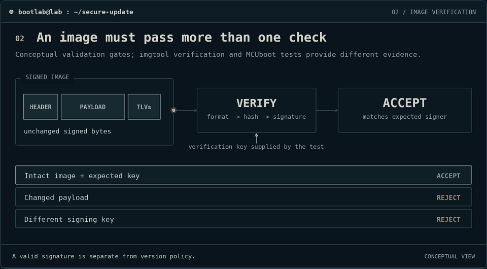
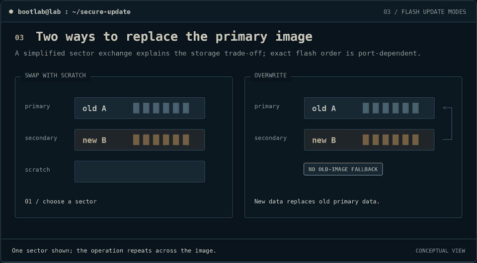
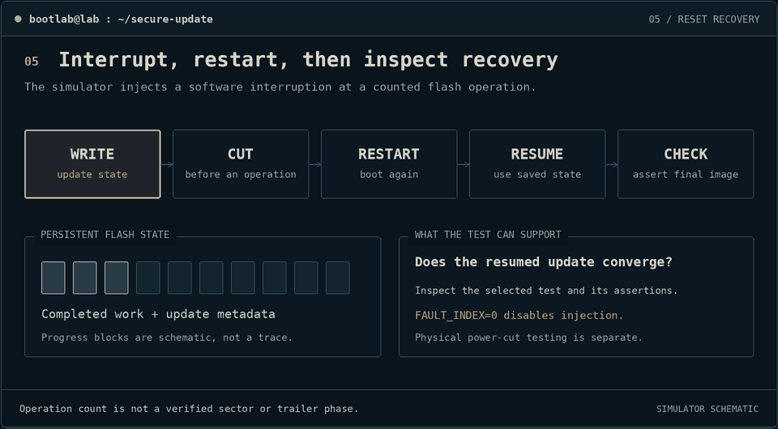
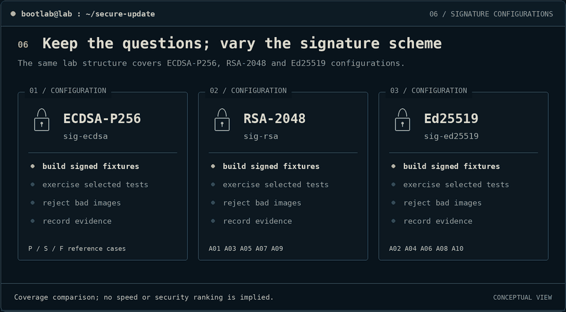
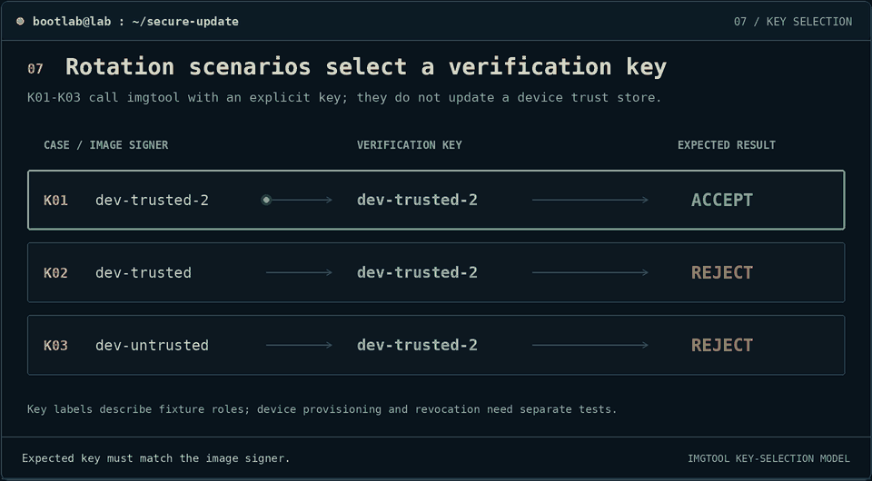
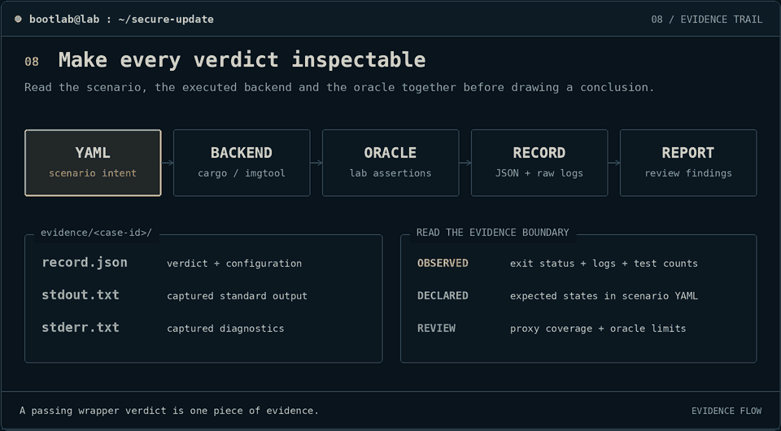

# BootLab — Secure boot & OTA update assurance

**See how an update is checked, installed, interrupted, and investigated.**

A reproducible lab around MCUboot: 33 scenario definitions, two execution backends, and evidence you can inspect. The animations explain the mechanisms; your local reports contain the results.

<picture>
  <source media="(max-width: 640px) and (prefers-reduced-motion: reduce) and (prefers-color-scheme: light)" srcset="assets/animations/header-light-mobile.png">
  <source media="(max-width: 640px) and (prefers-reduced-motion: reduce)" srcset="assets/animations/header-dark-mobile.png">
  <source media="(prefers-reduced-motion: reduce) and (prefers-color-scheme: light)" srcset="assets/animations/header-light.png">
  <source media="(prefers-reduced-motion: reduce)" srcset="assets/animations/header-dark.png">
  <source media="(max-width: 640px) and (prefers-color-scheme: light)" srcset="assets/animations/header-light-mobile.gif">
  <source media="(max-width: 640px)" srcset="assets/animations/header-dark-mobile.gif">
  <source media="(prefers-color-scheme: light)" srcset="assets/animations/header-light.gif">
  
</picture>

A visual guide to the lab. Coverage labels describe the repository, not the result of a test run.

<sub>Still image: [dark](assets/animations/header-dark.png) · [light](assets/animations/header-light.png)</sub>

[Start running](#02--run-the-lab) · [Visual walkthrough](WALKTHROUGH.md) · [Scenario matrix](docs/TEST_MATRIX.md) · [Documentation map](docs/README.md) · [Animation gallery](preview.html)

<sub>Apache-2.0 · Python 3.10+ · MCUboot simulator + imgtool · Dark/light visuals with reduced-motion PNGs. Open `preview.html` locally to switch theme or pause all animations.</sub>

## `01 / understand the update`

An over-the-air (**OTA**) update puts a new firmware image on a device. Before handing control to it, the bootloader must establish that the image is authentic, its bytes are intact, and the configured update policy allows it. An interrupted installation also needs a defined recovery path.

| Part | What it means | Why it matters |
|---|---|---|
| **Primary slot** | Flash area from which the application boots | Holds the current or newly installed image |
| **Secondary slot** | Flash area used to stage an update | Keeps incoming bytes separate until installation |
| **Scratch** | Temporary space used by the reference swap algorithm | Helps exchange the two images sector by sector |
| **Trailer** | Update status stored near the end of a slot | Lets MCUboot track swap progress and confirmation |
| **Oracle** | BootLab's rule for evaluating a backend result | Turns test output into a recorded verdict |

<picture>
  <source media="(prefers-reduced-motion: reduce) and (prefers-color-scheme: light)" srcset="assets/animations/lifecycle-light.png">
  <source media="(prefers-reduced-motion: reduce)" srcset="assets/animations/lifecycle-dark.png">
  <source media="(prefers-color-scheme: light)" srcset="assets/animations/lifecycle-light.gif">
  
</picture>

**Read the sequence:** stage → validate → install → trial → confirm or revert. Interruption recovery depends on the configured update mode.

<sub>Still image: [dark](assets/animations/lifecycle-dark.png) · [light](assets/animations/lifecycle-light.png)</sub>

The diagrams are conceptual: arrows show the update story, not a captured instruction trace. BootLab uses two separate execution paths:

| Execution path | What actually runs | What the evidence supports |
|---|---|---|
| `mcuboot_sim` | Selected upstream Rust tests with images built inside the simulator | The selected tests and their internal assertions, under the requested Cargo features |
| `imgtool_verify` | `imgtool verify` against a generated corpus image and selected key | Host-side image verification and its exit status |

The corpus is **not injected into simulator flash** by the current adapter. Expected versions and states in YAML are scenario intent; the Python oracle does not independently parse a booted-image trace. See [evidence limitations](docs/LIMITATIONS.md) for the consequences.

## `02 / run the lab`

Run these commands from the **BootLab directory**. You need Python 3.10+, a Rust/C build toolchain, and a populated `vendor/mcuboot/` tree including its dependencies. The first Cargo build can take several minutes. [Detailed setup](docs/REPRODUCIBILITY.md) · [Docker](docs/DOCKER.md)

```bash
python3 -m venv .venv
source .venv/bin/activate
python -m pip install -e ".[dev]"
python -m pip install ./vendor/mcuboot/scripts

# Create development keys and signed / mutated image fixtures.
bootlab build-corpus

# Start with a single upstream simulator proxy.
bootlab run-scenario scenarios/P01_boot_v1.yaml

# Evaluate all 33 scenario definitions and write the report.
bootlab run-matrix
```

Read `evidence/report.md` and the per-case logs after the run. A `PASS` means the current oracle accepted a backend result; read the [matrix notes](docs/TEST_MATRIX.md) before treating it as a security guarantee.

| Next step | Command |
|---|---|
| Follow the guided tutorial | `bootlab tutorial` |
| Run the tutorial without prompts | `bootlab tutorial --non-interactive` |
| Capture the upstream baseline log with a no-cut fault index | `FAULT_INDEX=0 bootlab baseline` |
| Compare the reference profiles | `bootlab compare-profiles mcuboot_swap_reference mcuboot_overwrite_reference` |
| Run setup, matrix, comparison, and a small fault sweep | `./scripts/reproduce.sh` |

Development keys in `fixtures/keys/` are generated locally. Keep the corpus manifest and run provenance if you need to compare results; fresh keys, signatures, timestamps, and toolchain differences mean a new run need not produce identical bytes.

## `03 / follow an image through verification`

Signing binds an image to a key. Verification checks the signed content using the selected verification key. Changing the payload, modifying signed header fields, or choosing a different key should prevent verification from succeeding.

<picture>
  <source media="(prefers-reduced-motion: reduce) and (prefers-color-scheme: light)" srcset="assets/animations/verification-light.png">
  <source media="(prefers-reduced-motion: reduce)" srcset="assets/animations/verification-dark.png">
  <source media="(prefers-color-scheme: light)" srcset="assets/animations/verification-light.gif">
  
</picture>

**Watch what changes:** the candidate bytes and selected key determine the verification result. A refusal keeps an unverified candidate from being treated as trusted.

<sub>Still image: [dark](assets/animations/verification-dark.png) · [light](assets/animations/verification-light.png)</sub>

The `S` scenarios separate payload integrity, signer trust, malformed input, slot size, and runtime rejection. An `imgtool` rejection is evidence about the host tool; `S06` exercises bad-signature handling through an upstream simulator test.

**Try it:** `bootlab run-scenario scenarios/S01_payload_flip.yaml`  
**Read it:** [all verification cases](WALKTHROUGH.md#verification-cases) · [threat model](docs/THREAT_MODEL.md)

## `04 / compare installation and recovery`

### Keep a fallback, or overwrite it

**Swap** exchanges the images and can retain the previous application for reversion. **Overwrite** replaces the primary image and does not provide swap-style rollback. Both use a staging slot in the reference configurations.

<picture>
  <source media="(prefers-reduced-motion: reduce) and (prefers-color-scheme: light)" srcset="assets/animations/swap-overwrite-light.png">
  <source media="(prefers-reduced-motion: reduce)" srcset="assets/animations/swap-overwrite-dark.png">
  <source media="(prefers-color-scheme: light)" srcset="assets/animations/swap-overwrite-light.gif">
  
</picture>

**Read the slots:** swap preserves the old image for a possible revert; overwrite replaces it. The animation describes the algorithms, while scenario coverage depends on the selected upstream test.

<sub>Still image: [dark](assets/animations/swap-overwrite-dark.png) · [light](assets/animations/swap-overwrite-light.png)</sub>

A trial image must be confirmed to stay installed in the swap flow. If it remains unconfirmed, a later boot can revert to the previous image. [Explore trial and confirmation](WALKTHROUGH.md#trial-cases).

### Interrupt a flash operation

BootLab's fault campaign interrupts modeled flash operations, retains simulated flash state, and reboots to exercise recovery. The counter applies to writes **and erases**; it is not a hardware power-cut measurement.

<picture>
  <source media="(prefers-reduced-motion: reduce) and (prefers-color-scheme: light)" srcset="assets/animations/fault-injection-light.png">
  <source media="(prefers-reduced-motion: reduce)" srcset="assets/animations/fault-injection-dark.png">
  <source media="(prefers-color-scheme: light)" srcset="assets/animations/fault-injection-light.gif">
  
</picture>

**Watch the interruption:** the next boot sees preserved flash state. A successful campaign must be interpreted alongside the selected index and the upstream recovery assertions.

<sub>Still image: [dark](assets/animations/fault-injection-dark.png) · [light](assets/animations/fault-injection-light.png)</sub>

In the current simulator, `FAULT_INDEX=0` makes **no cut**, while `1` cuts before the first counted operation. The `F03` and `F04` names describe intended boundary coverage, but their fixed indices do not establish a sector-copy or trailer location. Read the [fault-case explanations](WALKTHROUGH.md#fault-cases) before interpreting a sweep.

```bash
bootlab fault-sweep --start 0 --end 10 --features sig-ecdsa
# evidence/fault_table.csv and evidence/fault_table.json
```

## `05 / vary the algorithm and verification key`

### Three algorithms in the scenario matrix

ECDSA-P256 is the reference algorithm. The `A01`–`A10` cases add RSA-2048 and Ed25519 boot, upgrade, rejection, and fault-campaign proxies. These are functional checks, not performance comparisons or a cryptographic strength ranking.

<picture>
  <source media="(prefers-reduced-motion: reduce) and (prefers-color-scheme: light)" srcset="assets/animations/algorithms-light.png">
  <source media="(prefers-reduced-motion: reduce)" srcset="assets/animations/algorithms-dark.png">
  <source media="(prefers-color-scheme: light)" srcset="assets/animations/algorithms-light.gif">
  
</picture>

**Same question, different algorithm:** can the selected test verify its images and handle its negative cases? No timing or strength comparison is implied.

<sub>Still image: [dark](assets/animations/algorithms-dark.png) · [light](assets/animations/algorithms-light.png)</sub>

The image factory also supports RSA-3072, but there is no dedicated RSA-3072 scenario family in this matrix. [Algorithm cases](WALKTHROUGH.md#algorithm-cases).

### Select the key that is trusted now

`K01` verifies an image with the new key. `K02` and `K03` check rejection when old-key or unrelated-key images are presented to that selected verifier. This models the acceptance decision after a key change; device enrollment, persistent revocation, and an OTA trust-store update are not implemented by these cases.

<picture>
  <source media="(prefers-reduced-motion: reduce) and (prefers-color-scheme: light)" srcset="assets/animations/key-lifecycle-light.png">
  <source media="(prefers-reduced-motion: reduce)" srcset="assets/animations/key-lifecycle-dark.png">
  <source media="(prefers-color-scheme: light)" srcset="assets/animations/key-lifecycle-light.gif">
  
</picture>

**Read the verifier:** each case selects one verification key. These cases do not update a device trust store.

<sub>Still image: [dark](assets/animations/key-lifecycle-dark.png) · [light](assets/animations/key-lifecycle-light.png)</sub>

**Try it:** `bootlab run-scenario scenarios/K01_trusted_rotation_key_accepted.yaml`  
**Read it:** [key lifecycle cases](WALKTHROUGH.md#key-cases).

## `06 / choose a scenario`

The matrix contains **33 YAML definitions**. Several definitions share an upstream test filter, so 33 scenarios do not mean 33 independent simulator test bodies.

| Family | Cases | Question to investigate | Start here |
|---|---:|---|---|
| Baseline | 4 | How do boot and upgrade proxies behave in swap and overwrite configurations? | [P01–P02O](WALKTHROUGH.md#baseline-cases) |
| Trial / confirm | 2 | Does the upstream flow revert an unconfirmed image and retain a confirmed one? | [P03–P04](WALKTHROUGH.md#trial-cases) |
| Integrity / authenticity / validation | 6 | What happens to changed bytes, wrong keys, malformed images, and oversized candidates? | [S01–S06](WALKTHROUGH.md#verification-cases) |
| Version policy | 2 | What does the selected downgrade test check with the feature enabled or absent? | [V01–V02](WALKTHROUGH.md#version-cases) |
| Fault recovery | 6 | How does the simulator behave at selected interruption indices? | [F01–F04, F01O–F02O](WALKTHROUGH.md#fault-cases) |
| Algorithm diversity | 10 | How do the selected proxies behave under RSA-2048 and Ed25519? | [A01–A10](WALKTHROUGH.md#algorithm-cases) |
| Verification-key lifecycle | 3 | Which images verify against the newly selected key? | [K01–K03](WALKTHROUGH.md#key-cases) |

For exact filenames, Cargo features, and caveats, use the [full test matrix](docs/TEST_MATRIX.md). In particular, overwrite revert proxies can skip their body, and the feature-disabled downgrade control does not demonstrate an accepted downgrade.

## `07 / inspect and share the evidence`

A scenario definition selects the backend and expectation. The backend produces logs, the oracle evaluates them, and the recorder saves the verdict and execution context.

<picture>
  <source media="(prefers-reduced-motion: reduce) and (prefers-color-scheme: light)" srcset="assets/animations/evidence-light.png">
  <source media="(prefers-reduced-motion: reduce)" srcset="assets/animations/evidence-dark.png">
  <source media="(prefers-color-scheme: light)" srcset="assets/animations/evidence-light.gif">
  
</picture>

**Follow the evidence:** scenario → backend → logs and oracle → record → report. The underlying logs explain what a verdict means.

<sub>Still image: [dark](assets/animations/evidence-dark.png) · [light](assets/animations/evidence-light.png)</sub>

```text
evidence/
├── P01/
│   ├── record.json          verdict, backend arguments, provenance, timing
│   ├── stdout.txt           captured standard output
│   └── stderr.txt           captured standard error
└── report.md                aggregate matrix report
```

Start with `backend_args` and `details` in the record, then read both logs. An expected refusal can pass the scenario; a backend process failure needs investigation. The current negative `imgtool` oracle uses the exit status and does not distinguish every parser failure from clean rejection.

| Output | Generate it | Read it |
|---|---|---|
| Sanitized report | `bootlab sanitize-report` | `evidence/report_sanitized.md` |
| Local dashboard | `bootlab generate-site` | `out/site/index.html` |
| One-page summary | `bootlab generate-onepager` | `out/onepager.md` |
| Record signatures | `bootlab sign-evidence` then `bootlab verify-evidence` | `evidence/<case>/record.json.sig` |
| Dependency inventory | `bootlab generate-sbom` | `evidence/sbom.json` |

Evidence signing authenticates the canonical record payload with a development Ed25519 key. It does not independently validate the test or sign the contents of the referenced logs. The SBOM is a CycloneDX-like inventory; validate it against your downstream requirements before integrating it.

<details>
<summary>Additional investigation commands</summary>

```bash
# Mutate image structures and retain crash reproducers.
bootlab fuzz-image --iterations 1000 --seed 42

# Run the installed dependency-audit tools.
./scripts/audit-dependencies.sh

```

[Reproducibility details](docs/REPRODUCIBILITY.md) · [Findings policy](docs/FINDINGS_POLICY.md)

</details>

## `08 / know the boundary`

| Scope boundary | Interpretation |
|---|---|
| Simulator and host tooling | No production-board boot or physical power-cut assurance |
| Upstream test proxies | Internal test assertions matter; YAML expectations are not a direct state trace |
| Logical interruptions | No voltage, clock, electromagnetic, or instruction-skip fault resistance claim |
| Development keys | Production provisioning, key custody, and persistent revocation remain outside the lab |
| Zephyr lane | An example app exists; the recorded `native_sim` flash-layout issue remains unresolved |
| Engineering evidence | Illustrative standards mappings are not certification or a compliance assessment |

[Limitations](docs/LIMITATIONS.md) · [Zephyr integration](docs/ZEPHYR_INTEGRATION.md)

## `09 / find your next document`

| Goal | Document |
|---|---|
| Understand every scenario visually | [Visual walkthrough](WALKTHROUGH.md) |
| Find setup, architecture, and investigation guides | [Documentation map](docs/README.md) |
| Reproduce a result | [Reproducibility](docs/REPRODUCIBILITY.md) and [toolchain](docs/TOOLCHAIN.md) |
| Understand the implementation | [Architecture and glossary](docs/ARCHITECTURE.md) |
| Diagnose a failed command | [Troubleshooting](docs/TROUBLESHOOTING.md) |
| Review attacker assumptions | [Threat model](docs/THREAT_MODEL.md) |
| Connect evidence to an assurance review | [Illustrative standards mappings](docs/README.md#assurance-mappings) |
| Add or improve a scenario | [Contributing](CONTRIBUTING.md) |
| Review the local simulator extension | [Extension notes](docs/FAULT_INJECTION.md) |
| Explore the diagrams | [Animation gallery](preview.html) |

```text
BootLab/
├── scenarios/              scenario definitions and backend arguments
├── profiles/               reference configuration descriptions
├── src/bootlab/             runner, image factory, oracle, evidence, reports
├── vendor/mcuboot/          MCUboot source and local simulator extension
├── app/                    optional Zephyr example
├── docs/                   setup, coverage, architecture, investigation
├── source/                 reproducible animation renderer
├── assets/animations/      dark/light GIFs and still PNGs
├── scripts/                reproduction, audit, and rendering commands
├── tests/                  harness tests
├── README.md               project overview
├── WALKTHROUGH.md          scenario-by-scenario guide
└── preview.html            local animation gallery
```

## `10 / source and license`

The vendored [MCUboot design](vendor/mcuboot/docs/design.md), [image-tool guide](vendor/mcuboot/docs/imgtool.md), and [simulator tests](vendor/mcuboot/sim/tests/core.rs) are useful companions when reading the diagrams. BootLab is licensed under [Apache-2.0](LICENSE).
