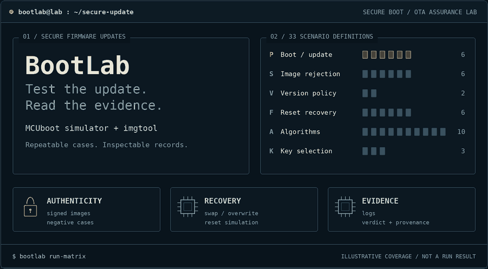
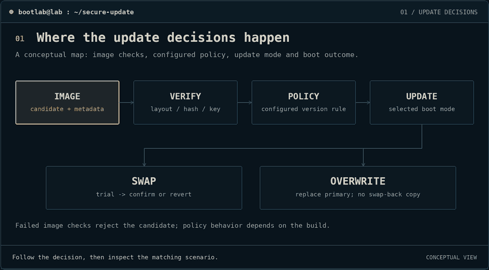
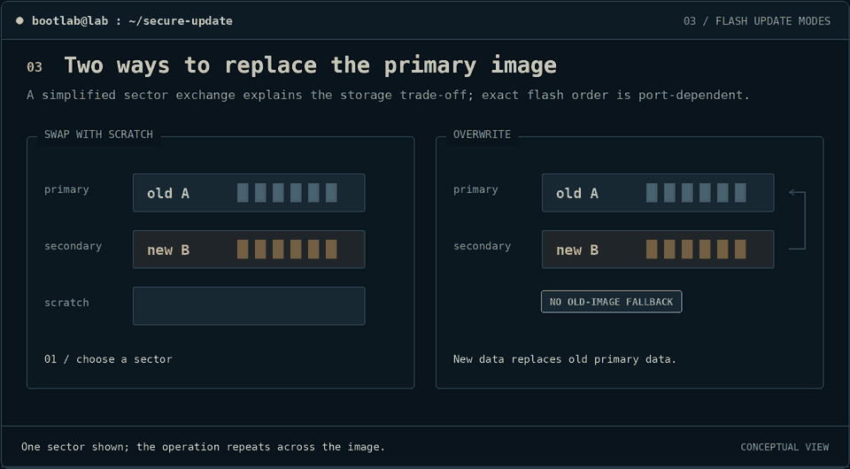
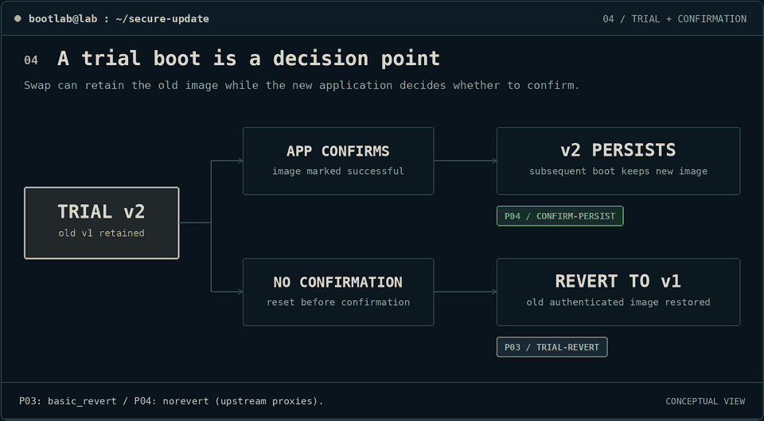
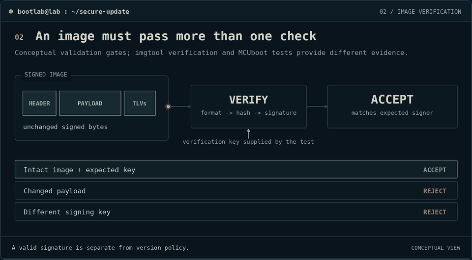
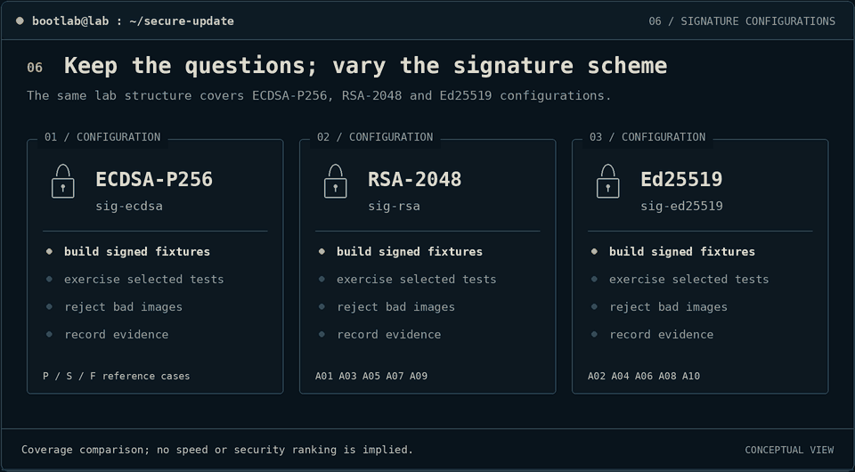
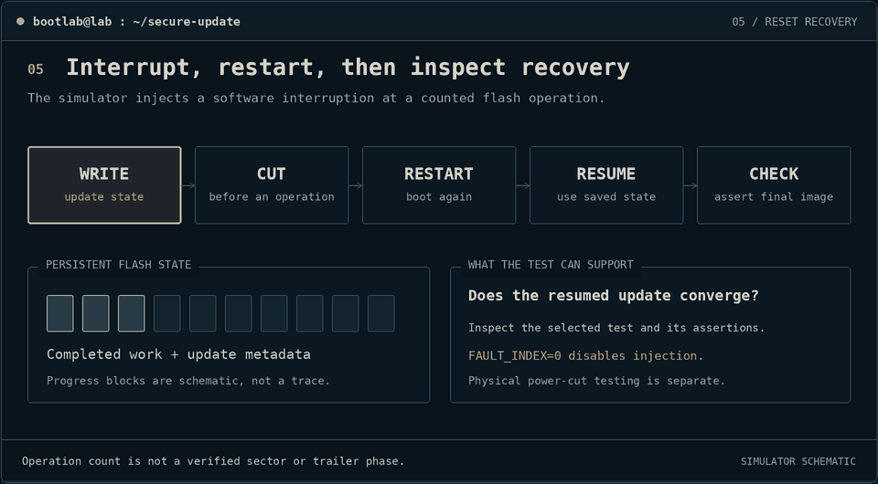
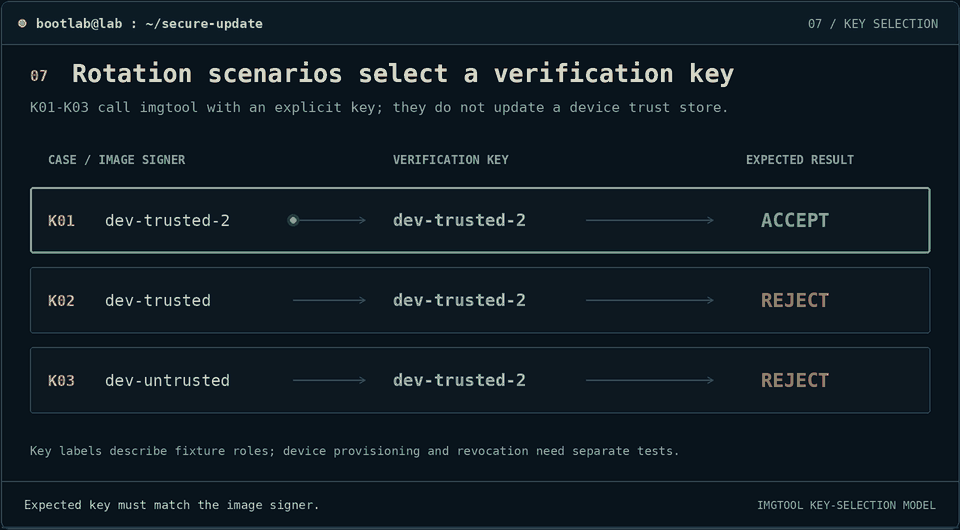
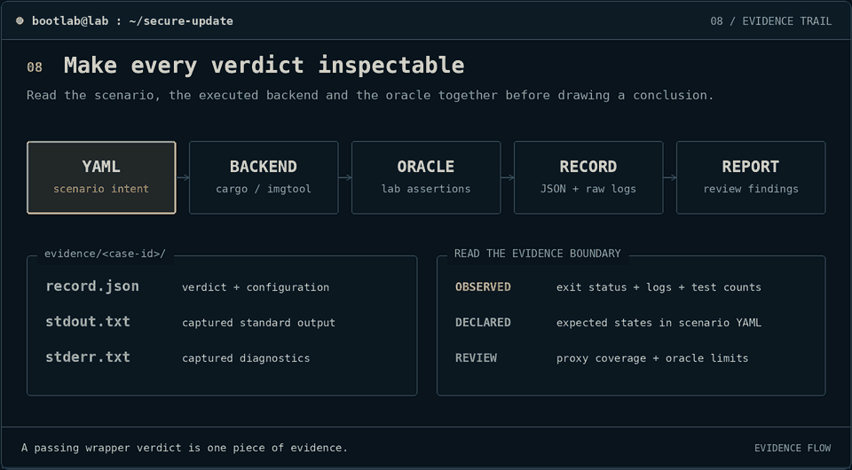

<picture>
  <source media="(max-width: 640px) and (prefers-reduced-motion: reduce) and (prefers-color-scheme: light)" srcset="assets/animations/header-light-mobile.png">
  <source media="(max-width: 640px) and (prefers-reduced-motion: reduce)" srcset="assets/animations/header-dark-mobile.png">
  <source media="(prefers-reduced-motion: reduce) and (prefers-color-scheme: light)" srcset="assets/animations/header-light.png">
  <source media="(prefers-reduced-motion: reduce)" srcset="assets/animations/header-dark.png">
  <source media="(max-width: 640px) and (prefers-color-scheme: light)" srcset="assets/animations/header-light-mobile.gif">
  <source media="(max-width: 640px)" srcset="assets/animations/header-dark-mobile.gif">
  <source media="(prefers-color-scheme: light)" srcset="assets/animations/header-light.gif">
  
</picture>

<sub>Educational graphics · Static header: [dark](assets/animations/header-dark.png) / [light](assets/animations/header-light.png) · [Project overview](README.md)</sub>

# BootLab — Visual Scenario Walkthrough

Follow an update from **signed bytes → boot decision → recovery → evidence**. This guide explains all **33 scenario definitions**, shows the behavior each is intended to explore, and identifies what its current backend actually checks.

The animations are conceptual illustrations. The commands and evidence records are how you inspect a real run.

<a id="start"></a>

## `01 / choose your route`

| Start with a question | Read | Scenario IDs |
|---|---|---|
| How does an update reach the primary slot? | [Boot and upgrade](#baseline) | [P01](#p01), [P02](#p02), [P01O](#p01o), [P02O](#p02o) |
| What happens if the application never confirms? | [Trial and confirmation](#trial) | [P03](#p03), [P04](#p04) |
| What if signed bytes change? | [Integrity](#integrity) | [S01](#s01), [S03](#s03) |
| What if the signer is untrusted? | [Authenticity](#authenticity) | [S02](#s02), [S06](#s06) |
| What if the image is incomplete or too large? | [Image validation](#validation) | [S04](#s04), [S05](#s05) |
| Can an older signed image be installed? | [Version policy](#version) | [V01](#v01), [V02](#v02) |
| Do selected checks work with other algorithms? | [Algorithm variants](#algorithms) | [A01–A10](#a01) |
| What happens at an interrupted flash operation? | [Fault campaign](#faults) | [F01](#f01), [F02](#f02), [F03](#f03), [F04](#f04), [F01O](#f01o), [F02O](#f02o) |
| How does selecting a different trusted key affect verification? | [Key selection](#keys) | [K01](#k01), [K02](#k02), [K03](#k03) |
| What can I inspect and share after a run? | [Evidence and reports](#evidence) | All scenarios |

**A short first pass:** [P02](#p02) → [P03/P04](#trial) → [S01](#s01) → [F02](#f02) → [read the evidence](#evidence).

### Read the flash diagrams

```text
                   PRIMARY            SECONDARY           SCRATCH
                 +------------+     +------------+      +------------+
                 | current    |     | candidate  |      | temporary  |
                 | image      |     | update     |      | swap data  |
                 +------------+     +------------+      +------------+

 [trusted]  signed by the selected trusted key
 [changed]  bytes modified after signing
 [trial]    new image awaiting application confirmation
 [reset]    simulated interruption at a flash-operation boundary
```

The primary slot holds the image selected for execution. The secondary slot stages the candidate. Swap-with-scratch uses temporary storage to exchange them; overwrite copies the candidate into primary. The application is not running while the bootloader performs that copy or swap.

### Understand the two kinds of evidence

| Backend | Executes | The Python oracle reads | Scope |
|---|---|---|---|
| `imgtool_verify` | `imgtool verify -k <key> <corpus-image>` | Process return code against `verify_rejected` | Offline verification of actual generated image bytes |
| `mcuboot_sim` | `cargo test --features <features> -- <filter>` | Exit status and Cargo passed/failed counts | Simulator test assertions using the simulator's own images |

**Scenario declarations and observations are different.** The simulator adapter does not load the YAML's primary/secondary corpus images into flash or parse an exact booted version. Values such as `booted_version: 2.0.0` describe intent; the record captures the selected test's result. Several IDs reuse the same test, and a Cargo filter can match multiple tests. A passing test can also contain a configuration-specific early return; those cases are called out below.

For offline negative cases, a nonzero `imgtool` exit satisfies the present oracle. Inspect `stderr.txt` to distinguish the expected verification refusal from another tool error. Missing executables, missing images, and adapter timeouts are recorded as infrastructure failures.

### Run a scenario

Complete the environment setup in the [README](README.md), then run commands from the `BootLab/` directory with its virtual environment active:

```bash
# Generate all algorithm variants and development signing keys.
bootlab build-corpus

# One scenario, with captured output and a JSON verdict.
bootlab run-scenario scenarios/P02_upgrade_v2.yaml

# All 33 definitions, with an aggregate report.
bootlab run-matrix
```

A scenario writes `evidence/<id>/record.json`, `stdout.txt`, and `stderr.txt`. Re-running that ID replaces those files. The matrix report reflects the checks that ran; the scenario count alone is not a count of independent security properties.

<a id="baseline"></a>
<a id="baseline-cases"></a>

## `02 / boot and upgrade`

The baseline introduces the two slot roles. A trusted image can boot from primary; an accepted candidate can become the next primary image.

<picture>
  <source media="(prefers-reduced-motion: reduce) and (prefers-color-scheme: light)" srcset="assets/animations/lifecycle-light.png">
  <source media="(prefers-reduced-motion: reduce)" srcset="assets/animations/lifecycle-dark.png">
  <source media="(prefers-color-scheme: light)" srcset="assets/animations/lifecycle-light.gif">
  
</picture>

<sub>Read left to right: preparation, decision, then outcome. Each stage has its own evidence boundary. · Static: [dark](assets/animations/lifecycle-dark.png) / [light](assets/animations/lifecycle-light.png).</sub>

<picture>
  <source media="(prefers-reduced-motion: reduce) and (prefers-color-scheme: light)" srcset="assets/animations/swap-overwrite-light.png">
  <source media="(prefers-reduced-motion: reduce)" srcset="assets/animations/swap-overwrite-dark.png">
  <source media="(prefers-color-scheme: light)" srcset="assets/animations/swap-overwrite-light.gif">
  
</picture>

<sub>Swap preserves the old image during the trial path. Overwrite does not provide that trial fallback. · Static: [dark](assets/animations/swap-overwrite-dark.png) / [light](assets/animations/swap-overwrite-light.png).</sub>

**Static state diagram — update modes**

```text
                          PRIMARY       SECONDARY      SCRATCH
Before either update      [old]         [new]          [unused]

Swap after exchange       [new: trial]  [old]          [temporary work]
  no confirmation         [old]         [new]          -> revert
  confirmation            [new]         [old bytes]    -> keep new

Overwrite after copy      [new]         [new/staging]  not used
  old primary bytes have been replaced; no trial rollback copy
```

<a id="p01"></a>

### P01 — Trusted v1 boot

`baseline` · `mcuboot_swap_reference` · `mcuboot_sim`

**Question:** can a trusted initial image participate in the normal boot path? This is the foundation for every update story.

**Concept:** `primary [v1 trusted] → authenticate → boot v1`.

**Current check:** the `basic_revert` filter with `sig-ecdsa` exercises the upstream swap/revert fixture. The oracle requires Cargo success. It does not isolate a primary-only boot or observe the declared `1.0.0` version.

```bash
bootlab run-scenario scenarios/P01_boot_v1.yaml
```

<a id="p02"></a>

### P02 — Trusted v2 upgrade

`baseline` · `mcuboot_swap_reference` · `mcuboot_sim`

**Question:** how does a staged trusted candidate replace the old primary image? This is the central OTA update path.

**Concept:** `[primary v1 | secondary v2] → swap → [primary v2 | secondary v1]`.

**Current check:** `basic_revert` with `sig-ecdsa`, the same invocation as P01 and P03. The fixture covers the swap/revert sequence. A pass supports that test's assertions; it does not establish an independently observed final `2.0.0` boot for this scenario ID.

```bash
bootlab run-scenario scenarios/P02_upgrade_v2.yaml
```

<a id="p01o"></a>

### P01O — Trusted boot under the overwrite configuration

`baseline` · `mcuboot_overwrite_reference` · `mcuboot_sim`

**Question:** does initial boot work with overwrite enabled? The intended starting state is `primary [v1 trusted]`.

**Current check:** `basic_revert` with `sig-ecdsa overwrite-only`. In the pinned simulator, `run_basic_revert()` returns immediately for overwrite mode. A Cargo pass here is a configuration smoke check, **not direct evidence of the intended boot**. The overwrite fault fixtures below provide stronger image-state checks.

```bash
bootlab run-scenario scenarios/P01_overwrite_boot.yaml
```

<a id="p02o"></a>

### P02O — Trusted v2 overwrite upgrade

`baseline` · `mcuboot_overwrite_reference` · `mcuboot_sim`

**Question:** can the candidate replace primary without keeping a trial rollback image?

**Concept:** `[primary v1 | secondary v2] → copy → [primary v2 | secondary v2]`.

**Current check:** the `norevert` filter with `sig-ecdsa overwrite-only`. `run_norevert()` returns early in this configuration; the filter also matches `norevert_newimage`, which checks a primary image that should stay unchanged. This scenario's pass does not by itself demonstrate the depicted v1-to-v2 copy. See [F01O/F02O](#f01o) for the overwrite upgrade helper.

```bash
bootlab run-scenario scenarios/P02_overwrite_upgrade.yaml
```

<a id="trial"></a>
<a id="trial-cases"></a>

## `03 / trial, confirm, or revert`

A valid signature says who signed an image. It does not establish that the application connects, reads its sensors, or completes startup. A trial boot gives the application a chance to check those conditions before confirming itself.

<picture>
  <source media="(prefers-reduced-motion: reduce) and (prefers-color-scheme: light)" srcset="assets/animations/trial-revert-light.png">
  <source media="(prefers-reduced-motion: reduce)" srcset="assets/animations/trial-revert-dark.png">
  <source media="(prefers-color-scheme: light)" srcset="assets/animations/trial-revert-light.gif">
  
</picture>

<sub>The branch is an application decision recorded in MCUboot trailer state. Confirmation makes the update persistent. · Static: [dark](assets/animations/trial-revert-dark.png) / [light](assets/animations/trial-revert-light.png).</sub>

**Static state diagram — the confirmation branch**

```text
 [v1 current] -> stage v2 -> [v2 trial; v1 retained]
                                      |
                      +---------------+---------------+
                      |                               |
              application confirms              no confirmation
                      |                               |
              [v2 persists]                    next boot reverts
                                                      |
                                                 [v1 restored]
```

<a id="p03"></a>

### P03 — Unconfirmed trial reverts

`trial` · `mcuboot_swap_reference` · `mcuboot_sim`

**Question:** after a trial boot without confirmation, does the old image return? This gives a device a recovery path when a new application cannot complete startup.

**Current check:** `basic_revert` with `sig-ecdsa`. The upstream helper runs repeated boot passes and checks that the old image is restored. The Python oracle accepts Cargo success; `1.0.0` remains the scenario's illustrative version label.

```bash
bootlab run-scenario scenarios/P03_trial_revert.yaml
```

<a id="p04"></a>

### P04 — Confirmed update persists

`trial` · `mcuboot_swap_reference` · `mcuboot_sim`

**Question:** once the application confirms the new image, does it survive the next boot?

**Current check:** `norevert` with `sig-ecdsa`. The upstream helper upgrades, checks image/trailer state, marks the primary image permanent, boots again, and checks that the new image remains. The filter also matches `norevert_newimage`. The oracle requires successful matching tests.

**Read the picture carefully:** old bytes may remain in secondary after confirmation, but they are no longer an automatic trial rollback promise.

```bash
bootlab run-scenario scenarios/P04_confirm_persist.yaml
```

<a id="integrity"></a>
<a id="verification-cases"></a>

## `04 / detect changed bytes`

A signature binds the image's authenticated content to a signing key. These cases deliberately change bytes after signing and send the resulting files to the host verifier.

<picture>
  <source media="(prefers-reduced-motion: reduce) and (prefers-color-scheme: light)" srcset="assets/animations/verification-light.png">
  <source media="(prefers-reduced-motion: reduce)" srcset="assets/animations/verification-dark.png">
  <source media="(prefers-color-scheme: light)" srcset="assets/animations/verification-light.gif">
  
</picture>

<sub>Integrity asks whether authenticated bytes changed. Authenticity asks whether the selected key verifies the signature. · Static: [dark](assets/animations/verification-dark.png) / [light](assets/animations/verification-light.png).</sub>

**Static state diagram — verify the artifact**

```text
   signed header + payload + verification metadata
                         |
                 mutate after signing
                         |
        +----------------+----------------+
        |                |                |
   payload bit      header byte      truncated file
        |                |                |
        +----------------+----------------+
                         |
                 imgtool verify -k key
                         |
               expected: nonzero exit
```

<a id="s01"></a>

### S01 — Payload bit flip

`integrity` · `mcuboot_swap_reference` · `imgtool_verify`

**Question:** does a post-signing payload edit fail verification? A damaged download or unauthorized patch should not retain its original signature's validity.

**Current check:** the image factory flips one bit at `header_size + 64` and writes `v2.0.0-trusted-payload-flip.bin`. Verification uses `dev-trusted`. The oracle passes when `imgtool` exits nonzero (`verify_rejected: true`). This observes offline rejection, not a device boot.

```bash
bootlab run-scenario scenarios/S01_payload_flip.yaml
```

<a id="s03"></a>

### S03 — Header byte mutation

`integrity` · `mcuboot_swap_reference` · `imgtool_verify`

**Question:** does changing authenticated header metadata invalidate the image?

**Current check:** the factory flips bit 0 of byte 16 and writes `v2.0.0-trusted-header-flip.bin`; `imgtool verify` is expected to return nonzero. The fixture is named `header_version_flip`, but the actual mutation is a fixed header offset. The test does not establish a particular edited version such as `0.0.2`.

```bash
bootlab run-scenario scenarios/S03_header_flip.yaml
```

<a id="authenticity"></a>

## `05 / reject the wrong signer`

A well-formed signature is useful only when it verifies under a key that the verifier trusts. The lab checks this at two different layers.

**Static state diagram — two evidence paths**

```text
 S02: corpus image signed by untrusted key
        -> host imgtool + trusted key -> rejection

 S06: simulator secondary with invalid signature
        -> MCUboot verification       -> primary remains intact
```

<a id="s02"></a>

### S02 — Untrusted key rejected offline

`authenticity` · `mcuboot_swap_reference` · `imgtool_verify`

**Question:** can a different private key produce an update accepted by the selected trusted key? It should not.

**Current check:** verify `v2.0.0-untrusted.signed.bin` using `dev-trusted`. The payload can be intact while verification still fails because the signer differs. The expected result is a nonzero exit.

```bash
bootlab run-scenario scenarios/S02_untrusted_key.yaml
```

<a id="s06"></a>

### S06 — Bad secondary signature rejected in the simulator

`authenticity` · `mcuboot_swap_reference` · `mcuboot_sim`

**Question:** does MCUboot refuse an invalid secondary signature before accepting an upgrade?

**Current check:** `bad_secondary_slot` with `sig-ecdsa` constructs a simulator image using `BadSignature` and exercises the bootloader's signature-failure path. A successful test produces the Python verdict `pass (rejection)`. This runs MCUboot code in the host simulator; it is not a physical-device measurement.

```bash
bootlab run-scenario scenarios/S06_bad_secondary_signature.yaml
```

<a id="validation"></a>

## `06 / reject unusable images`

An image must have a usable structure and fit the destination. These checks explore incomplete input and a candidate larger than its slot.

**Static state diagram — two distinct failures**

```text
 S04  complete file -> keep first half only -> verifier rejects
 S05  candidate larger than slot          -> upgrade refused
                                            primary preserved
```

<a id="s04"></a>

### S04 — Truncated image

`validation` · `mcuboot_swap_reference` · `imgtool_verify`

**Question:** does the verifier refuse an incomplete signed image?

**Current check:** the factory keeps the first half of the signed file as `v2.0.0-trusted-truncated.bin`. The scenario filename refers to TLV metadata, but this is a coarse file truncation, not a precise mutation of a chosen tag-length-value field. The oracle expects a nonzero verifier exit. Check stderr when assessing parser behavior; the oracle does not classify the rejection reason.

```bash
bootlab run-scenario scenarios/S04_truncated_tlv.yaml
```

<a id="s05"></a>

### S05 — Oversized secondary image

`validation` · `mcuboot_swap_reference` · `mcuboot_sim`

**Question:** is a candidate that cannot fit handled without replacing the valid primary?

**Current check:** `oversized_secondary_slot` with `sig-ecdsa` creates an oversized simulator candidate and calls the upstream helper that checks a failed upgrade with primary intact. A successful test produces `pass (rejection)`.

```bash
bootlab run-scenario scenarios/S05_oversized_secondary.yaml
```

<a id="version"></a>
<a id="version-cases"></a>

## `07 / separate authenticity from version policy`

An older image can still have a valid signature. Downgrade prevention adds a separate policy decision: should this otherwise authentic image replace the current one?

**Static state diagram — intended policy comparison**

```text
 current v2 + authentic candidate v1.5
                    |
          +---------+---------+
          |                   |
     policy enabled      policy disabled
          |                   |
   reject downgrade      no version-policy barrier

 Current coverage: V01 checks refusal in the upstream fixture.
                   V02's helper returns early; acceptance is not observed.
```

Both scenario commands below select **overwrite-only** Cargo features. Their YAML profile labels do not change that executable configuration. These checks concern image-version policy; the profiles do not enable a hardware security counter.

<a id="v01"></a>

### V01 — Downgrade-prevention feature enabled

`version` · declared profile `mcuboot_policy_downgrade_enabled` · `mcuboot_sim`

**Question:** does the upstream fixture retain primary when presented with an older candidate under the enabled policy?

**Current check:** `downgrade_prevention` with `sig-ecdsa downgrade-prevention overwrite-only`. The pinned `run_nodowngrade()` helper invokes MCUboot and checks that the original primary image remains.

**Read the verdict:** the YAML allows both `secure_refusal` and `new_authenticated_image`. The current Python oracle therefore takes its success/control branch and reports `pass (control)` for Cargo success. The helper's assertions provide the refusal evidence; BootLab does not independently parse the candidate decision or exact versions. Narrowing the declaration and improving the oracle remain useful follow-up work.

```bash
bootlab run-scenario scenarios/V01_downgrade_enabled.yaml
```

<a id="v02"></a>

### V02 — Downgrade-prevention feature disabled

`version` · declared profile `mcuboot_swap_reference` · `mcuboot_sim`

**Question:** how is the policy-disabled configuration represented?

**Current check:** the same filter with `sig-ecdsa overwrite-only`. When downgrade prevention is absent, the pinned `run_nodowngrade()` helper returns immediately. A `pass (control)` is therefore a configuration control, **not evidence that an older image was accepted**. A paired image-injection test is needed to observe the full on/off behavioral contrast.

```bash
bootlab run-scenario scenarios/V02_downgrade_disabled_control.yaml
```

<a id="algorithms"></a>
<a id="algorithm-cases"></a>

## `08 / repeat selected checks with RSA and Ed25519`

The ECDSA-P256 cases establish the main stories. Ten variants repeat selected boot, update, integrity, authenticity, and fault configurations with RSA-2048 and Ed25519. They are coverage variants, not a cryptographic strength or performance comparison.

<picture>
  <source media="(prefers-reduced-motion: reduce) and (prefers-color-scheme: light)" srcset="assets/animations/algorithms-light.png">
  <source media="(prefers-reduced-motion: reduce)" srcset="assets/animations/algorithms-dark.png">
  <source media="(prefers-color-scheme: light)" srcset="assets/animations/algorithms-light.gif">
  
</picture>

<sub>The algorithm changes; the test question stays recognizable. Coverage differs by scenario and backend. · Static: [dark](assets/animations/algorithms-dark.png) / [light](assets/animations/algorithms-light.png).</sub>

| Algorithm | Simulator feature | Corpus key type | Variant profile |
|---|---|---|---|
| ECDSA-P256 | `sig-ecdsa` | `ecdsa-p256` | `mcuboot_swap_reference` |
| RSA-2048 | `sig-rsa` | `rsa-2048` | `mcuboot_swap_rsa2048_reference` |
| Ed25519 | `sig-ed25519` | `ed25519` | `mcuboot_swap_ed25519_reference` |

The simulator variants use the upstream test's images. The `imgtool_verify` variants use the corresponding generated corpus files and key type. The current corpus builder also supports RSA-3072; these ten scenario definitions do not add an RSA-3072 lane.

<a id="a01"></a>

### A01 — Trusted v1 boot with RSA-2048

`baseline` · `mcuboot_sim`

The [P01](#p01) boot intention with `sig-rsa`. The `basic_revert` filter must pass; the exact `1.0.0` version is a declaration, not a parsed result.

```bash
bootlab run-scenario scenarios/A01_rsa_boot_v1.yaml
```

<a id="a02"></a>

### A02 — Trusted v1 boot with Ed25519

`baseline` · `mcuboot_sim`

The [P01](#p01) boot intention with `sig-ed25519`. The oracle requires the `basic_revert` filter to pass, with the same proxy-test boundary as A01.

```bash
bootlab run-scenario scenarios/A02_ed25519_boot_v1.yaml
```

<a id="a03"></a>

### A03 — Trusted v2 upgrade with RSA-2048

`baseline` · `mcuboot_sim`

The [P02](#p02) upgrade intention with `sig-rsa`. This runs the same `basic_revert` invocation as A01; it is not a second independent image-injection test.

```bash
bootlab run-scenario scenarios/A03_rsa_upgrade_v2.yaml
```

<a id="a04"></a>

### A04 — Trusted v2 upgrade with Ed25519

`baseline` · `mcuboot_sim`

The [P02](#p02) upgrade intention with `sig-ed25519`. This runs the same `basic_revert` invocation as A02. Cargo success is the observed result.

```bash
bootlab run-scenario scenarios/A04_ed25519_upgrade_v2.yaml
```

<a id="a05"></a>

### A05 — RSA-2048 payload bit flip

`integrity` · `imgtool_verify`

The [S01](#s01) mutation on `v2.0.0-trusted-payload-flip-rsa2048.bin`. Verification with the trusted RSA-2048 key must return nonzero.

```bash
bootlab run-scenario scenarios/A05_rsa_payload_flip.yaml
```

<a id="a06"></a>

### A06 — Ed25519 payload bit flip

`integrity` · `imgtool_verify`

The [S01](#s01) mutation on `v2.0.0-trusted-payload-flip-ed25519.bin`. Verification with the trusted Ed25519 key must return nonzero.

```bash
bootlab run-scenario scenarios/A06_ed25519_payload_flip.yaml
```

<a id="a07"></a>

### A07 — RSA-2048 untrusted key

`authenticity` · `imgtool_verify`

The [S02](#s02) signer mismatch using `v2.0.0-untrusted-rsa2048.signed.bin`. Verification selects `dev-trusted` with key type `rsa-2048` and must return nonzero.

```bash
bootlab run-scenario scenarios/A07_rsa_untrusted_key.yaml
```

<a id="a08"></a>

### A08 — Ed25519 untrusted key

`authenticity` · `imgtool_verify`

The [S02](#s02) signer mismatch using `v2.0.0-untrusted-ed25519.signed.bin`. Verification selects `dev-trusted` with key type `ed25519` and must return nonzero.

```bash
bootlab run-scenario scenarios/A08_ed25519_untrusted_key.yaml
```

<a id="a09"></a>

### A09 — RSA-2048 fault-index-zero control

`fault` · `mcuboot_sim`

Runs `fault_campaign_upgrade` with `sig-rsa` and `FAULT_INDEX=0`. Despite the legacy “reset before write” filename, zero does not interrupt the pinned simulator. The helper checks the completed upgrade. See [counter semantics](#fault-counter).

```bash
bootlab run-scenario scenarios/A09_rsa_reset_before_write.yaml
```

<a id="a10"></a>

### A10 — Ed25519 fault-index-zero control

`fault` · `mcuboot_sim`

Runs `fault_campaign_upgrade` with `sig-ed25519` and `FAULT_INDEX=0`. This is the Ed25519 counterpart to A09: a completed-upgrade control, without an injected cut.

```bash
bootlab run-scenario scenarios/A10_ed25519_reset_before_write.yaml
```

<a id="faults"></a>
<a id="fault-cases"></a>

## `09 / interrupt and resume flash operations`

The fault extension selects an operation count, invokes MCUboot, and resumes if the simulator interrupts execution. It checks final image and trailer state. This explores logical recovery at write/erase boundaries; it does not emulate a physical voltage glitch or a partially programmed flash cell.

<picture>
  <source media="(prefers-reduced-motion: reduce) and (prefers-color-scheme: light)" srcset="assets/animations/fault-injection-light.png">
  <source media="(prefers-reduced-motion: reduce)" srcset="assets/animations/fault-injection-dark.png">
  <source media="(prefers-color-scheme: light)" srcset="assets/animations/fault-injection-light.gif">
  
</picture>

<sub>The illustrated interruption is a simulator event. Numeric indices select operation boundaries, not measured physical times. · Static: [dark](assets/animations/fault-injection-dark.png) / [light](assets/animations/fault-injection-light.png).</sub>

**Static state diagram — the fault helper**

```text
 construct simulator images
             |
 mark candidate permanent
             |
 boot_go(counter = N) ---> interrupted? ---> boot_go(counter = 0)
             |                                     |
             +------------------+------------------+
                                |
                       verify final state
                                |
                primary = new image
                secondary = old image (swap modes)
                expected trailer flags
```

The helper checks a **completed permanent upgrade** after any resume. The broader `outcome_in` lists and illustrative boot versions in YAML are not additional state observations.

<a id="fault-counter"></a>

### What `FAULT_INDEX` means in this checkout

The pinned C simulator decrements its counter **before** each flash write or erase and interrupts when that decrement reaches zero. Reads do not use this counter.

| Value | Effective behavior | How to interpret it |
|---|---|---|
| `0` | Counter becomes negative; no interruption | Completed-upgrade control |
| `1` | Interrupt before the first counted operation | Earliest injected cut |
| `N > 1` | Interrupt before operation N, if reached | N−1 counted operations have completed |
| Beyond the run's operation count | No interruption reached | A pass alone does not prove a cut occurred |

The existing scenario filenames predate this clarification. In particular, `reset_before_write` uses zero and `reset_after_first_write` uses one. IDs and filenames are retained so commands and evidence remain traceable.

F03/F04 choose larger counters. Their names suggest sector/trailer phases, but there is no captured address/phase trace establishing that mapping for every simulated device and configuration. Inspect the [extension notes](docs/FAULT_INJECTION.md) before claiming a specific cut location.

<a id="f01"></a>

### F01 — Swap index-zero control

`fault` · `mcuboot_swap_reference` · `FAULT_INDEX=0`

**Intent:** the YAML names an interruption before a destination write. **Actual execution:** `fault_campaign_upgrade` with `sig-ecdsa` runs without an injected cut, then checks the new primary, old secondary, and expected trailers. Its declared `booted_version: 1.0.0` is not parsed by the oracle.

```bash
bootlab run-scenario scenarios/F01_reset_before_write.yaml
```

<a id="f02"></a>

### F02 — Swap interruption before the first operation

`fault` · `mcuboot_swap_reference` · `FAULT_INDEX=1`

**Question:** can the permanent upgrade finish after the earliest simulated interruption? The first counted operation has not yet changed flash when the counter trips.

**Current check:** `fault_campaign_upgrade` with `sig-ecdsa`; resume and verify final new-primary/old-secondary state and trailers. The legacy filename says “after first write”; the current counter actually stops before the first write or erase.

```bash
bootlab run-scenario scenarios/F02_reset_after_first_write.yaml
```

<a id="f03"></a>

### F03 — Swap operation index 50

`fault` · `mcuboot_swap_reference` · `FAULT_INDEX=50`

**Question:** does recovery converge at a later selected operation boundary?

**Current check:** the same helper with index 50, interrupting before the 50th counted write/erase if reached. The filename calls this a sector boundary; the evidence does not identify the affected sector or operation type. A successful helper checks the completed upgrade state.

```bash
bootlab run-scenario scenarios/F03_sector_boundary.yaml
```

<a id="f04"></a>

### F04 — Swap operation index 570

`fault` · `mcuboot_swap_reference` · `FAULT_INDEX=570`

**Question:** does the helper preserve its final image/trailer invariants for this larger selected counter?

**Current check:** `fault_campaign_upgrade` at index 570. This only injects a cut if the run reaches that operation. The filename suggests trailer metadata, but neither the Python oracle nor the record proves that the interrupted operation was a trailer write. Avoid treating this case as evidence that all partial trailer writes recover.

```bash
bootlab run-scenario scenarios/F04_trailer_metadata.yaml
```

<a id="f01o"></a>

### F01O — Overwrite index-zero control

`fault` · `mcuboot_overwrite_reference` · `FAULT_INDEX=0`

**Question:** does the permanent overwrite upgrade reach the helper's expected final state?

**Current check:** `fault_campaign_upgrade` with `sig-ecdsa overwrite-only`. Zero runs without a cut. The helper checks the new primary and expected trailers; it does not require the old image in secondary for overwrite mode. This is a stronger upgrade-state check than the early-return baseline filters.

```bash
bootlab run-scenario scenarios/F01_overwrite_reset_before_write.yaml
```

<a id="f02o"></a>

### F02O — Overwrite interruption before the first operation

`fault` · `mcuboot_overwrite_reference` · `FAULT_INDEX=1`

**Question:** can the overwrite upgrade complete after the earliest counted interruption?

**Current check:** the overwrite helper resumes after the cut and checks the final new primary and trailers. Because the cut happens before the first counted operation, this particular index does not demonstrate recovery from a partly overwritten primary. Later indices require their own runs and evidence.

```bash
bootlab run-scenario scenarios/F02_overwrite_reset_after_first_write.yaml
```

To explore additional indices and save a table:

```bash
bootlab fault-sweep --start 0 --end 10 --features sig-ecdsa
# evidence/fault_table.csv and evidence/fault_table.json
```

<a id="keys"></a>
<a id="key-cases"></a>

## `10 / select the trusted verification key`

These cases model a key transition using offline verifier calls. Each call selects **one key file**. The profile's two-key list is descriptive metadata; it is not an on-device enrollment or revocation mechanism exercised by these tests.

<picture>
  <source media="(prefers-reduced-motion: reduce) and (prefers-color-scheme: light)" srcset="assets/animations/key-lifecycle-light.png">
  <source media="(prefers-reduced-motion: reduce)" srcset="assets/animations/key-lifecycle-dark.png">
  <source media="(prefers-color-scheme: light)" srcset="assets/animations/key-lifecycle-light.gif">
  
</picture>

<sub>K01–K03 select dev-trusted-2 for imgtool verification. Device trust-store updates are outside these checks. · Static: [dark](assets/animations/key-lifecycle-dark.png) / [light](assets/animations/key-lifecycle-light.png).</sub>

**Static state diagram — the actual verification matrix**

```text
 selected verification key: dev-trusted-2

 K01  image signed by dev-trusted-2  -> accept
 K02  image signed by dev-trusted    -> reject
 K03  image signed by dev-untrusted  -> reject
```

<a id="k01"></a>

### K01 — Rotation-key image accepted

`authenticity` · `mcuboot_key_rotation` · `imgtool_verify`

**Question:** does the new key verify an image signed by its corresponding private key?

**Current check:** verify `v2.0.0-trusted-2.signed.bin` with `fixtures/keys/dev-trusted-2-ecdsa-p256.pem`. The expected exit code is zero (`verify_rejected: false`). This demonstrates matching-key acceptance in the host verifier.

```bash
bootlab run-scenario scenarios/K01_trusted_rotation_key_accepted.yaml
```

<a id="k02"></a>

### K02 — Old-key image rejected by the new key

`authenticity` · `mcuboot_key_rotation` · `imgtool_verify`

**Question:** when verification selects only the new key, does an old-key signature fail?

**Current check:** verify `v2.0.0-trusted.signed.bin` with the same `dev-trusted-2` key file. A nonzero exit passes the check. This models the outcome of selecting a new trust anchor; it does not perform a persistent key revocation operation.

```bash
bootlab run-scenario scenarios/K02_old_key_rejected_after_rotation.yaml
```

<a id="k03"></a>

### K03 — Untrusted-key image rejected

`authenticity` · `mcuboot_key_rotation` · `imgtool_verify`

**Question:** does a signature from outside the selected trust relationship fail verification?

**Current check:** verify `v2.0.0-untrusted.signed.bin` with `dev-trusted-2`. The expected result is a nonzero exit. The fixture represents a revoked or never-trusted signer; no revocation list is processed.

```bash
bootlab run-scenario scenarios/K03_revoked_key_rejected.yaml
```

<a id="evidence"></a>

## `11 / turn a run into reviewable evidence`

Start with the scenario's JSON record, follow its backend arguments to the exact test or image, then read the captured output. This preserves the connection between a green verdict and the assertion that produced it.

<picture>
  <source media="(prefers-reduced-motion: reduce) and (prefers-color-scheme: light)" srcset="assets/animations/evidence-light.png">
  <source media="(prefers-reduced-motion: reduce)" srcset="assets/animations/evidence-dark.png">
  <source media="(prefers-color-scheme: light)" srcset="assets/animations/evidence-light.gif">
  
</picture>

<sub>Reports summarize records. Detached signatures authenticate record content under the selected local signer key. · Static: [dark](assets/animations/evidence-dark.png) / [light](assets/animations/evidence-light.png).</sub>

### Read one case

```bash
python -m json.tool evidence/P02/record.json
cat evidence/P02/stdout.txt
cat evidence/P02/stderr.txt
```

| Record field | What to look for |
|---|---|
| `case_id`, `profile`, `backend` | Which definition and evidence layer produced this result? |
| `backend_args` | Which Cargo features/filter or image/key were actually selected? |
| `mcuboot_commit` | Which vendored revision was recorded? |
| `passed`, `verdict`, `infrastructure_error` | Did the oracle accept the result, or did execution fail? |
| `details` | Passed/failed test counts or the verifier's return code |
| `stdout_path`, `stderr_path` | Where to inspect the underlying command output |
| `timestamp_utc`, `elapsed_seconds` | When the run was recorded and how long it took |

An evidence directory grows as you run the relevant commands:

```text
evidence/
├── P02/
│   ├── record.json             run-scenario / run-matrix
│   ├── stdout.txt
│   ├── stderr.txt
│   └── record.json.sig         added by sign-evidence
├── report.md                   run-matrix
├── report_sanitized.md         sanitize-report
├── comparison.md               compare-profiles
├── fault_table.csv             fault-sweep
├── fault_table.json
├── sbom.json                   generate-sbom
├── fuzz_results.json           fuzz-image
└── reproducers/                saved mutation findings, if any

out/
├── site/index.html             generate-site
└── onepager.md                 generate-onepager
```

### Build the views you need

```bash
# Aggregate all scenario results from this run.
bootlab run-matrix
cat evidence/report.md

# Summarize existing records without raw logs or host paths.
bootlab sanitize-report
cat evidence/report_sanitized.md

# Compare the existing scenario sets for these profile IDs.
bootlab compare-profiles mcuboot_swap_reference mcuboot_overwrite_reference
cat evidence/comparison.md

# Add and verify detached signatures over canonical record content.
bootlab sign-evidence
bootlab verify-evidence

# Produce a dashboard, one-page summary, and dependency inventory.
bootlab generate-site
bootlab generate-onepager
bootlab generate-sbom
```

`compare-profiles` compares available cases; the two profiles do not necessarily contain identical coverage. Evidence signatures cover canonical JSON record content, not the bytes in separately referenced log files. A valid signature authenticates the record under the selected signer key; it does not make an assertion stronger than the test that supplied it.

### Explore parser mutations

```bash
bootlab fuzz-image --iterations 1000 --seed 42
# Results: evidence/fuzz_results.json
# Findings: evidence/reproducers/ when a reproducer is saved
```

This command mutates a generated image and runs `imgtool verify`. The seed makes mutation selection repeatable against the same starting bytes. The harness stops early on an accepted mutation or crash finding, saves a reproducer, and returns a failing exit code. It tests the host verifier; it does not fuzz MCUboot on a device.

<a id="next"></a>

## `12 / continue from the evidence`

| Need | Read next |
|---|---|
| Setup, architecture, and the project map | [README](README.md) |
| Exact scenario coverage and backend limitations | [Test matrix](docs/TEST_MATRIX.md) |
| How a command becomes an evidence record | [Architecture and glossary](docs/ARCHITECTURE.md) |
| Setup failures or surprising verdicts | [Troubleshooting](docs/TROUBLESHOOTING.md) |
| Attacker capabilities and security boundaries | [Threat model](docs/THREAT_MODEL.md) |
| Flash-counter implementation and local extension | [Fault-injection reference](docs/FAULT_INJECTION.md) |
| Repeatable builds, keys, and provenance | [Reproducibility](docs/REPRODUCIBILITY.md) |
| Container setup | [Docker and devcontainer guide](docs/DOCKER.md) |
| Evidence-to-requirement working templates | [Standards mapping templates](docs/cert_mapping/) |

The standards templates help organize evidence; they are not compliance or certification results. For technical claims, keep the scenario definition, effective backend configuration, underlying assertions, and captured result together.

[Back to the scenario map](#start)
