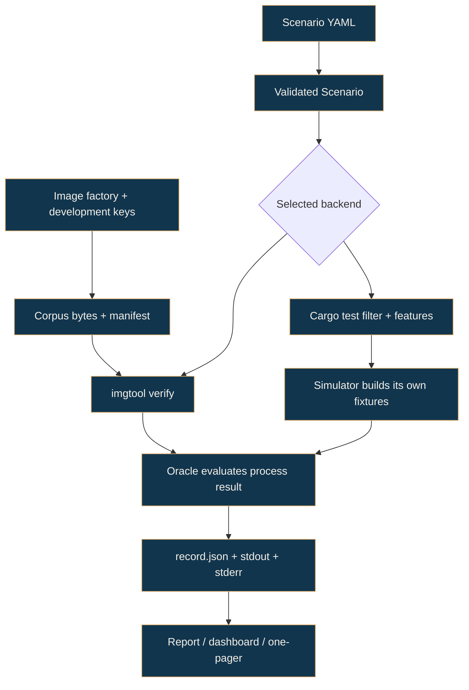
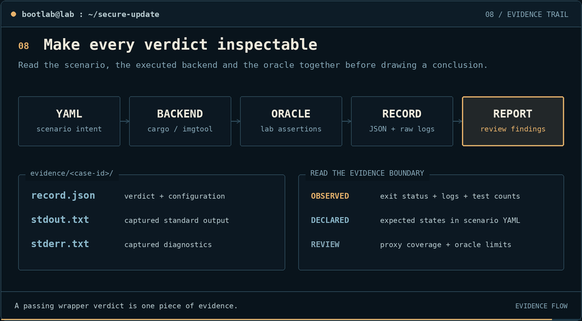

# Architecture and glossary

[Project overview](../README.md) · [Visual walkthrough](../WALKTHROUGH.md) · [Documentation map](README.md)

**BootLab connects a test definition to a process, an oracle, and an evidence record.** Its two backends share that workflow while exercising different inputs. This guide follows those boundaries through the code.

## 01 / Two paths through the lab



There is deliberately no arrow from the corpus to simulator flash: the current adapter does not perform that injection. A shared scenario label or version string does not make the two paths use identical bytes.

## 02 / Follow one command

From `BootLab/`, after setup and corpus generation:

```bash
bootlab run-scenario scenarios/S01_payload_flip.yaml
```

| Step | Implementation | What happens |
|---|---|---|
| 1. Resolve workspace | [cli.py](../src/bootlab/cli.py), `main` | Uses the current directory unless `--workspace` selects another root |
| 2. Load definition | [scenario.py](../src/bootlab/scenario.py), `load_scenario` | Parses YAML and validates fields with Pydantic |
| 3. Select backend | [mcuboot_sim.py](../src/bootlab/backends/mcuboot_sim.py), `McubootSimAdapter.run` | Chooses `imgtool_verify` for S01 |
| 4. Execute | `_run_imgtool_verify` | Resolves the image under `artifacts/corpus/` and invokes the selected key |
| 5. Evaluate | [oracles.py](../src/bootlab/oracles.py), `evaluate` | Compares the process result with the case expectation |
| 6. Record | [evidence.py](../src/bootlab/evidence.py), `record_evidence` | Saves the verdict, backend arguments, timing, provenance, and logs |
| 7. Return | `run_scenario` | Exits zero for an accepted oracle result, one otherwise |

S01 expects verification to fail. Therefore, a **nonzero verifier exit can produce a passing BootLab scenario**. The current oracle does not distinguish every failure cause; a traceback in stderr still needs investigation.

For a simulator scenario, step 4 runs:

```text
cargo test --features <cargo_features> -- <cargo_test_filter>
```

Cargo receives a substring filter, not `--exact`. A filter such as `norevert` may select more than one test. The adapter adds `RUST_LOG=warn` and the scenario's explicit environment variables, including `FAULT_INDEX` for fault cases.

## 03 / Know which fields drive execution

| Scenario data | Current role |
|---|---|
| `id`, `name`, `category` | Identity, reporting, and category-specific oracle behavior |
| `backend` | Selects host verification or simulator execution |
| `backend_args.image` and key fields | Choose actual verifier input and verification key |
| `backend_args.cargo_test`, `cargo_features`, `env` | Choose the actual simulator invocation |
| `profile` | Label for filtering/reporting; the profile YAML is not automatically applied by the adapter |
| `primary`, `secondary`, `operation` | Describe intended scenario semantics; do not automatically stage corpus bytes in simulator flash |
| `fault` | Describes intended interruption; actual simulator configuration comes from the environment in `backend_args` |
| `expect.verify_rejected` | Controls host-verifier acceptance/rejection expectation |
| `expect.outcome_in` | Used by selected oracle logic; not a list of independently observed runtime states |
| `expect.booted_version`, `recovery_boots` | Declared intent; not independently measured by the Python adapter |

Schema validation checks that the definition is structurally acceptable. It does not prove that every declared expectation is enforced. [Evidence limitations](LIMITATIONS.md) describes the most consequential examples.

## 04 / Read the evidence in layers

<picture>
  <source media="(prefers-color-scheme: light)" srcset="../assets/animations/evidence-light.png">
  
</picture>

The record connects the case and the oracle decision. The logs let you inspect the process that led to it. The report makes many records easier to scan.

| Record field | How to use it |
|---|---|
| `case_id`, `case_name`, `backend`, `profile` | Identify what was requested and which execution path ran |
| `backend_args` | Inspect effective image/key selection or test/features/environment |
| `passed`, `verdict`, `assertion_result` | Read the oracle's conclusion, not an independent hardware measurement |
| `details` | See backend-specific counters or verifier status used in that conclusion |
| `mcuboot_commit` | Identify vendor Git HEAD when available; `unknown` if metadata is unavailable |
| `timestamp_utc`, `elapsed_seconds` | Place the run in time; duration includes process/build overhead |
| `stdout_path`, `stderr_path` | Open captured output relative to the workspace |
| `notes` | Read the scenario author's context; it is copied intent, not additional observation |

`run-matrix` adds an aggregate report. `run-scenario` writes one case's record and logs without regenerating the matrix report. Running the same ID again replaces its case directory contents. Archive a complete run before further experiments if the previous result needs to remain reviewable.

The corpus manifest contains input hashes separately. Record signatures cover canonical JSON, excluding the signature metadata itself; they do not authenticate the bytes of the files named by the log paths. See [retention guidance](REPRODUCIBILITY.md#04--retain-a-reviewable-run).

## 05 / Where the other commands fit

| Command family | Implementation | Input → output |
|---|---|---|
| `build-corpus` | [images.py](../src/bootlab/images.py) | Image recipes + keys → signed/mutated files + manifest |
| `fault-sweep` | [fault_plan.py](../src/bootlab/fault_plan.py) | Numeric indices + features → per-index logs + CSV/JSON |
| `fuzz-image` | [fuzz_image.py](../src/bootlab/fuzz_image.py) | Base image + seed → mutation outcomes + retained reproducers |
| Reports | [reports.py](../src/bootlab/reports.py) | Records → readable summaries |
| `generate-site` | [site_generator.py](../src/bootlab/site_generator.py) | Existing evidence → local dashboard |
| `generate-onepager` | [onepager.py](../src/bootlab/onepager.py) | Existing evidence → Markdown summary |
| Documentation graphics | [render_bootlab.py](../source/render_bootlab.py) | Drawing code → conceptual GIFs and PNGs |

The fault sweep evaluates process success through its own path; it does not use every assertion in the scenario oracle. The fuzzer uses a separate accepted/rejected/crash classifier and stops at its first accepted mutation or crash. Reports and graphics do not strengthen the underlying experiment.

## 06 / Terms used throughout the repository

| Term | Meaning here |
|---|---|
| **Authenticity** | Whether verification succeeds with the selected trusted key |
| **Integrity** | Whether authenticated bytes remain consistent with their signed representation |
| **OTA** | Over-the-air firmware update; BootLab focuses on image and boot behavior, not download transport |
| **Primary / secondary** | Execution slot / candidate staging slot in the reference model |
| **Scratch** | Temporary flash used by swap-with-scratch |
| **Trailer** | Update metadata used to track progress and confirmation |
| **TLV** | Type-length-value record used for image metadata |
| **Trial / confirm / revert** | Try a new image, retain it after confirmation, or return to the previous image |
| **Downgrade policy** | A rule controlling acceptance of an older signed image |
| **Proxy test** | An existing test used to represent a named scenario; its actual assertions define the scope |
| **Oracle** | Code that decides whether observed backend output satisfies a case |
| **Fault index** | Counter input for a modeled write/erase interruption; not a timestamp or proven flash phase |
| **Provenance** | Information connecting a result to its source, tools, configuration, and inputs |

Use [the walkthrough](../WALKTHROUGH.md) to see these terms in the individual scenarios and [troubleshooting](TROUBLESHOOTING.md) when the observed result differs from the expected story.
