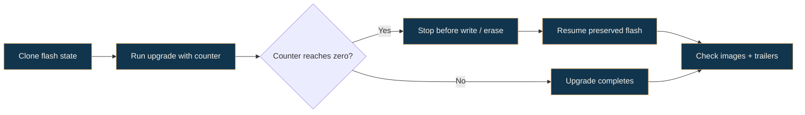

# Deterministic fault injection

[Project overview](../README.md) · [Visual walkthrough](../WALKTHROUGH.md) · [Documentation map](README.md)

**Run a simulated upgrade with a selected flash-operation interruption, then inspect the resulting image and trailer checks.** The test and helper implementation live in the vendored MCUboot source.

## 01 / Implementation map

| Location | Entry point | Purpose |
|---|---|---|
| [sim/src/image.rs](../vendor/mcuboot/sim/src/image.rs) | `run_upgrade_with_fault_at(index, permanent)` | Calls the existing `try_upgrade(Some(index), permanent)` |
| Same file | `run_fault_campaign_observation(index)` | Returns the recovery assertion, cut-reached flag, and total operation count |
| [sim/tests/fault_campaign.rs](../vendor/mcuboot/sim/tests/fault_campaign.rs) | `fault_campaign_probe` | Prints operation counts for modeled configurations |
| Same file | `fault_campaign_upgrade` | Reads `FAULT_INDEX`, iterates modeled devices, and asserts the helper reports no failure |

For a swap upgrade, the helper checks the new image in primary, the old image in secondary, and final trailer flags. The old-secondary check is conditional on swap mode; trailer checks still apply to the other configured modes.

## 02 / Counter behavior



The C simulator decrements the counter **before** each counted write/erase and interrupts when the result becomes zero. Index `0` is a no-cut baseline; index `1` stops before the first counted operation. A requested index beyond the operation count also finishes without interruption. Patch 0002 emits a per-configuration ordinal, reached flag, total operation count, and final recovery assertion. It does not identify the underlying device layout or report the exact flash operation/location.

## 03 / Reproduce the extension directly

From `BootLab/`, show successful-test output with `--nocapture`:

```bash
cargo test --manifest-path vendor/mcuboot/sim/Cargo.toml \
  --features sig-ecdsa --test fault_campaign \
  fault_campaign_probe -- --exact --nocapture

FAULT_INDEX=1 cargo test --manifest-path vendor/mcuboot/sim/Cargo.toml \
  --features sig-ecdsa --test fault_campaign \
  fault_campaign_upgrade -- --exact --nocapture
```

The probe prints one `FAULT_PROBE configuration=... total_ops=...` line per exercised configuration. The harness preserves each count; do not assume one count applies to every layout.

The Python interface is:

```bash
bootlab fault-sweep --indices 0,1,50 --features sig-ecdsa
```

It writes sweep CSV/JSON, per-configuration records, and per-index stdout/stderr under `evidence/runs/<run-id>/fault_sweep/`. Every requested index must return the complete probed configuration set. A positive index counts only when the per-configuration result explicitly reports `reached=true`; otherwise it is `NOT_REACHED` and fails coverage. Index zero is recorded as `NO_CUT_BASELINE`.

## 04 / Interpret the result

A passing helper supports its final image/trailer assertions for each emitted modeled configuration and records whether the requested cut was reached. Configuration IDs include the simulator device name, alignment, and erased value. The operation's flash address/type is not emitted, so sector/trailer labels remain unobserved. No result describes a physical device.

Use [the fault-case walkthrough](../WALKTHROUGH.md#fault-cases) for scenario-specific counter values and [the evidence limitations](LIMITATIONS.md) for the scope of the resulting records.
