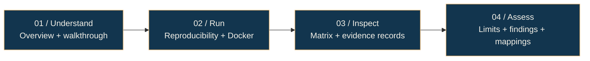

# BootLab documentation map

[Project overview](../README.md) · [Visual walkthrough](../WALKTHROUGH.md) · [Documentation map](README.md)

**Choose a route: understand the model, reproduce a run, or review its evidence.** Commands in these guides run from the `BootLab/` directory unless stated otherwise.

## 01 / Understand

| Read | What you will learn |
|---|---|
| [Project overview](../README.md) | What BootLab does and how to start |
| [Visual walkthrough](../WALKTHROUGH.md) | Image validation, updates, fault recovery, and evidence flow |
| [Threat model](THREAT_MODEL.md) | Assets, attacker capabilities, and trust boundaries |
| [Limitations](LIMITATIONS.md) | What each backend can establish and where claims stop |
| [Architecture and glossary](ARCHITECTURE.md) | Follow a command through the code and understand its terms |

## 02 / Reproduce

| Read | What it helps you do |
|---|---|
| [Reproducibility](REPRODUCIBILITY.md) | Run the matrix and retain the right artifacts |
| [Toolchain](TOOLCHAIN.md) | Record dependencies, configuration, and provenance |
| [Docker and devcontainer](DOCKER.md) | Build a container, run commands, and retain evidence |
| [Zephyr integration](ZEPHYR_INTEGRATION.md) | Understand the optional board lane and its unresolved build work |
| [Version demo app](../app/zephyr_version_demo/README.md) | Build the small application once a board configuration is ready |
| [Troubleshooting](TROUBLESHOOTING.md) | Diagnose setup failures and surprising results |

## 03 / Review and extend

| Read | What it helps you do |
|---|---|
| [Test matrix](TEST_MATRIX.md) | Inspect all 33 scenario definitions and backend expectations |
| [Findings policy](FINDINGS_POLICY.md) | Separate security violations, parser failures, and harness errors |
| [Fault injection](FAULT_INJECTION.md) | Run the deterministic fault helper and interpret its counter |
| [Contributing](../CONTRIBUTING.md) | Add a case, command, or visual explanation |
| [Animation gallery](../preview.html) | Explore the diagrams in both themes, with motion or still frames |

## 04 / Prepare traceability

The [IEC 62443-4-2](cert_mapping/iec_62443_4_2.md), [ISO/SAE 21434](cert_mapping/iso_sae_21434.md), and [EU CRA](cert_mapping/eu_cra.md) templates organize engineering evidence. They deliberately leave exact regulatory or standards clauses to the product's assessment work.

**Reading rule:** diagrams explain the model; `evidence/<case_id>/record.json` and its logs describe an actual run. A documented expectation is not a stored result.
