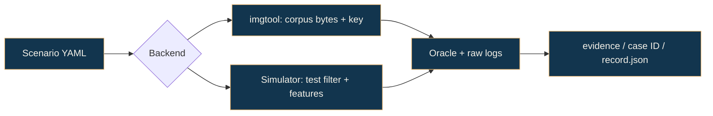

# Scenario matrix and evidence map

[Project overview](../README.md) · [Visual walkthrough](../WALKTHROUGH.md) · [Documentation map](README.md)

**33 scenario definitions, two backends, and explicit limits on each conclusion.** This is the coverage specification. Current verdicts belong in the generated `evidence/report.md`, not in permanent PASS badges here.

## 01 / Read a row

- **Simulator** means a named upstream test filter, using internally generated images. Cargo filters may match more than one test.
- **Verifier** means host-side `imgtool verify` against a corpus file and selected key.
- **Expected check** describes the current oracle or helper. It is not a claim that this checkout has passed a run.



## 02 / Boot and update intent · 6 cases

| ID | Intended scenario | Executed test / mode | Expected check and scope |
|---|---|---|---|
| P01 | Boot trusted v1 | `basic_revert`, swap / ECDSA | Cargo success; shared revert-test proxy, no measured v1 banner |
| P02 | Upgrade to trusted v2 | `basic_revert`, swap / ECDSA | Same proxy as P01; no corpus-v2 injection |
| P03 | Trial then revert | `basic_revert`, swap / ECDSA | Upstream revert checks succeed |
| P04 | Confirm and persist | `norevert`, swap / ECDSA | Upstream non-revert checks succeed; filter also matches `norevert_newimage` |
| P01O | Boot under overwrite | `basic_revert`, overwrite / ECDSA | Helper returns early in overwrite mode; does not establish this boot path |
| P02O | Upgrade under overwrite | `norevert`, overwrite / ECDSA | Main helper returns early; matching `norevert_newimage` is a separate check, not proof of full copying |

## 03 / Integrity, authenticity, and format · 6 cases

| ID | Input or behavior | Backend | Expected check |
|---|---|---|---|
| S01 | Payload bit flipped after signing | Verifier / ECDSA | Nonzero verifier exit |
| S02 | Image signed by an untrusted key | Verifier / ECDSA | Nonzero verifier exit |
| S03 | Signed header/version bytes mutated | Verifier / ECDSA | Nonzero verifier exit |
| S04 | Truncated image / malformed TLV area | Verifier / ECDSA | Nonzero verifier exit; inspect stderr for parser crashes |
| S05 | Oversized secondary image | Simulator / `oversized_secondary_slot` | Upstream rejection assertions succeed |
| S06 | Bad secondary signature | Simulator / `bad_secondary_slot` | Upstream rejection assertions succeed |

The verifier cases do not execute the bootloader. A nonzero return code alone does not distinguish clean rejection from an unhandled exception.

## 04 / Version policy · 2 cases

| ID | Executed features | Current behavior and limit |
|---|---|---|
| V01 | `sig-ecdsa downgrade-prevention overwrite-only` | Calls upstream `downgrade_prevention`, which checks the primary remains unchanged when policy is enabled. BootLab's YAML allows refusal **or** a new authenticated image, so its oracle uses Cargo success rather than its strict-refusal branch. |
| V02 | `sig-ecdsa overwrite-only` | Disabled-policy control. Upstream `run_nodowngrade` returns early when prevention is disabled; a pass does not demonstrate acceptance of an older image. |

Both execute overwrite-only. V02's profile label is `mcuboot_swap_reference`, and V01's profile file also describes swap; `backend_args.cargo_features` controls the actual invocation. Neither case injects the declared BootLab v2/v1.5 corpus pair into the simulator.

## 05 / Flash-operation campaigns · 6 cases

All rows select `fault_campaign_upgrade`, which checks the final new image and trailer state, and also the old secondary image in swap mode.

| ID | Mode | `FAULT_INDEX` | Actual counter meaning |
|---|---|---|---|
| F01 | Swap / ECDSA | `0` | No-cut baseline; the counter decrements below zero |
| F02 | Swap / ECDSA | `1` | Interruption before the first counted write/erase operation |
| F03 | Swap / ECDSA | `50` | Interruption before operation 50, if reached |
| F04 | Swap / ECDSA | `570` | Interruption before operation 570, if reached |
| F01O | Overwrite / ECDSA | `0` | No-cut baseline |
| F02O | Overwrite / ECDSA | `1` | Interruption before the first counted operation |

The existing scenario names for F01/F02 describe different timing; the source counter behavior above is authoritative. F03/F04 labels are not measured sector/trailer events. The helper does not expose a reached/interrupted flag, so a passing F04 may include a device configuration whose upgrade finishes before index 570.

## 06 / Signature algorithms · 10 cases

| ID | Algorithm | Backend / input | Expected check |
|---|---|---|---|
| A01 | RSA-2048 | Simulator / `basic_revert` | Shared baseline/revert proxy succeeds |
| A02 | Ed25519 | Simulator / `basic_revert` | Shared baseline/revert proxy succeeds |
| A03 | RSA-2048 | Simulator / `basic_revert` | Shared upgrade/revert proxy succeeds |
| A04 | Ed25519 | Simulator / `basic_revert` | Shared upgrade/revert proxy succeeds |
| A05 | RSA-2048 | Verifier / payload mutation | Nonzero verifier exit |
| A06 | Ed25519 | Verifier / payload mutation | Nonzero verifier exit |
| A07 | RSA-2048 | Verifier / untrusted signer | Nonzero verifier exit |
| A08 | Ed25519 | Verifier / untrusted signer | Nonzero verifier exit |
| A09 | RSA-2048 | Simulator / fault index `0` | No-cut final-state check succeeds |
| A10 | Ed25519 | Simulator / fault index `0` | No-cut final-state check succeeds |

The corpus also supports RSA-3072. There is no dedicated RSA-3072 runtime row in the current matrix.

## 07 / Selected-key verification · 3 cases

| ID | Image signer | Verification key | Expected check |
|---|---|---|---|
| K01 | `dev-trusted-2` | `dev-trusted-2` | Verifier accepts |
| K02 | Original `dev-trusted` | `dev-trusted-2` | Verifier rejects |
| K03 | `dev-untrusted` | `dev-trusted-2` | Verifier rejects |

These are **host key-selection examples**. They do not perform device-side rotation, update a trust store, or demonstrate persistent revocation. The profile's multi-key description does not change the single `-k` key selected by each case.

## 08 / Run and inspect

From `BootLab/` with the environment active:

```bash
bootlab build-corpus
bootlab run-matrix
bootlab run-scenario scenarios/F02_reset_after_first_write.yaml
```

| Generated artifact | Producer |
|---|---|
| `evidence/<id>/record.json`, `stdout.txt`, `stderr.txt` | `run-scenario` or `run-matrix` |
| `evidence/report.md` | `run-matrix` |
| `evidence/comparison.md` | `compare-profiles` |
| `evidence/fault_table.csv`, `fault_table.json` | `fault-sweep` |
| `evidence/report_sanitized.md` | `sanitize-report` |
| `evidence/<id>/record.json.sig` | Optional `sign-evidence` |
| `evidence/sbom.json` | `generate-sbom` |
| `evidence/fuzz_results.json` | `fuzz-image` |
| `out/site/`, `out/onepager.md` | `generate-site`, `generate-onepager` |

See [limitations](LIMITATIONS.md), [findings policy](FINDINGS_POLICY.md), and [reproducibility](REPRODUCIBILITY.md) before interpreting these artifacts as an assurance claim.
