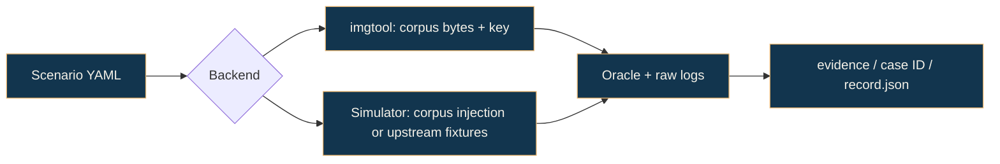

# Scenario matrix and evidence map

[Project overview](../README.md) · [Visual walkthrough](../WALKTHROUGH.md) · [Documentation map](README.md)

**35 scenario definitions, two simulator modes, and explicit limits on each conclusion.** Run `bootlab validate-scenarios` to verify current definitions and profile contents. Current verdicts belong in run-scoped evidence, not permanent PASS badges here.

## 01 / Read a row

- **Direct simulator** means the `bootlab_direct_image` test with primary and candidate bytes injected into MCUboot's nrf52840 modeled slots. The adapter verifies image format, version, signature algorithm, trust expectation, and layout; the oracle checks injected hashes and final selection.
- **Proxy simulator** means a named upstream test using internally generated fixtures. Cargo must report that exact test as executed.
- **Verifier** means host-side `imgtool verify` against a corpus file and selected key.
- **Expected check** describes the current oracle or helper. It is not a claim that this checkout has passed a run.



## 02 / Boot and update intent · 7 cases

| ID | Intended scenario | Executed test / mode | Expected check and scope |
|---|---|---|---|
| P01 | Boot trusted v1 | `basic_revert`, swap / ECDSA | Cargo success; shared revert-test proxy, no measured v1 banner |
| P02 | Upgrade to trusted v2 | `basic_revert`, swap / ECDSA | Same proxy as P01; no corpus-v2 injection |
| A01–A02 | RSA-2048 / Ed25519 boot | `basic_revert`, swap | Proxy assertions with selected algorithm features |
| A03–A04 | RSA-2048 / Ed25519 upgrade | `basic_revert`, swap | Proxy assertions with selected algorithm features |
| D01 | Authenticated v1 to v2 upgrade | `bootlab_direct_image`, overwrite / ECDSA | Injected hashes match corpus inputs; candidate selected and version 2.0.0 observed |
| P03 | Trial then revert | `basic_revert`, swap / ECDSA | Upstream revert checks succeed |
| P04 | Confirm and persist | `norevert`, swap / ECDSA | Upstream non-revert checks succeed; filter also matches `norevert_newimage` |

The proxy rows use MCUboot's simulator-built fixture images. The obsolete overwrite helper no-op definitions were removed when direct overwrite coverage was added.

## 02a / Trial and confirmation · 2 cases

| ID | Intended scenario | Executed test / mode | Expected check and scope |
|---|---|---|---|
| P03 | Trial then revert | `basic_revert`, swap / ECDSA | Upstream revert checks succeed |
| P04 | Confirm and persist | `norevert`, swap / ECDSA | Upstream non-revert checks succeed; filter also matches `norevert_newimage` |

## 03 / Integrity, authenticity, and format · 15 definitions including direct cases

| ID | Input or behavior | Backend | Expected check |
|---|---|---|---|
| S01 | Payload bit flipped after signing | Verifier / ECDSA | Nonzero verifier exit |
| S02 | Image signed by an untrusted key | Verifier / ECDSA | Nonzero verifier exit |
| S03 | Signed header/version bytes mutated | Verifier / ECDSA | Nonzero verifier exit |
| S04 | Truncated image / malformed TLV area | Verifier / ECDSA | Nonzero verifier exit; inspect stderr for parser crashes |
| S05 | Oversized secondary image | Simulator / `oversized_secondary_slot` | Upstream rejection assertions succeed |
| S06 | Bad secondary signature | Simulator / `bad_secondary_slot` | Upstream rejection assertions succeed |
| D02 | Payload-mutated signed candidate | Direct simulator / ECDSA | Primary image remains selected; injected hashes match the corpus bytes |
| D03 | Valid image signed by untrusted key | Direct simulator / ECDSA | Primary image remains selected; trusted primary stays selected |

The verifier cases do not execute the bootloader. A nonzero return code alone does not distinguish clean rejection from an unhandled exception.

## 04 / Version policy · 2 direct cases

| ID | Executed features | Current behavior and limit |
|---|---|---|
| V01 | `sig-ecdsa downgrade-prevention overwrite-only` | Injects the trusted v2 primary and v1.5 candidate; requires primary selection and version 2.0.0. |
| V02 | `sig-ecdsa overwrite-only` | Injects the identical bytes with downgrade prevention disabled; requires candidate selection and version 1.5.0. |

Both use the same signed corpus inputs and modeled flash layout. Cargo features differ only by `downgrade-prevention`. The observed choice is the bootloader-selected image; no application code is executed.

## 05 / Flash-operation campaigns · 9 definitions

All rows select `fault_campaign_upgrade`, which checks the final new image and trailer state, and also the old secondary image in swap mode.

| ID | Mode | `FAULT_INDEX` | Actual counter meaning |
|---|---|---|---|
| F01 | Swap / ECDSA | `0` | No-cut baseline; the counter decrements below zero |
| F02 | Swap / ECDSA | `1` | Interruption before the first counted write/erase operation |
| F03 | Swap / ECDSA | `50` | Interruption before operation 50, if reached |
| F04 | Swap / ECDSA | `300` | Reached interruption before operation 300 |
| F01O | Overwrite / ECDSA | `0` | No-cut baseline |
| F02O | Overwrite / ECDSA | `1` | Interruption before the first counted operation |
| D06 | Direct overwrite / ECDSA | `1` | Asserts the interruption was reached, then checks the selected candidate and recovery state |

F03/F04 are numeric indices, not measured sector/trailer events. The sweep probes operation counts per configuration, requires the same unique configuration set for every requested index, and treats an unreached request as a failure. Default sweeps use the common reachable range; explicit out-of-range selections remain `NOT_REACHED` failures. It asserts one exact Rust test ran and checks that recovery flags agree with each image/trailer observation.

## 06 / Signature algorithms · 10 cases

| ID | Algorithm | Backend / input | Expected check |
|---|---|---|---|
| A01 | RSA-2048 | Simulator / `basic_revert` | Shared baseline/revert proxy succeeds |
| A02 | Ed25519 | Simulator / `basic_revert` | Shared baseline/revert proxy succeeds |
| A03 | RSA-2048 | Simulator / `basic_revert` | Shared upgrade/revert proxy succeeds |
| A04 | Ed25519 | Simulator / `basic_revert` | Shared upgrade/revert proxy succeeds |
| A05 | RSA-2048 | Verifier / payload mutation | Nonzero verifier exit |
| A06 | Ed25519 | Verifier / payload mutation | Nonzero verifier exit |
| A07 | RSA-2048 | Verifier / untrusted signer | Nonzero verifier exit |
| A08 | Ed25519 | Verifier / untrusted signer | Nonzero verifier exit |
| A09 | RSA-2048 | Simulator / fault index `0` | No-cut final-state check succeeds |
| A10 | Ed25519 | Simulator / fault index `0` | No-cut final-state check succeeds |

The corpus also supports RSA-3072. There is no dedicated RSA-3072 runtime row in the current matrix.

## 07 / Selected-key verification · 3 cases

| ID | Image signer | Verification key | Expected check |
|---|---|---|---|
| K01 | `dev-trusted-2` | `dev-trusted-2` | Verifier accepts |
| K02 | Original `dev-trusted` | `dev-trusted-2` | Verifier rejects |
| K03 | `dev-untrusted` | `dev-trusted-2` | Verifier rejects |

These are **host key-selection examples**. They do not perform device-side rotation, update a trust store, or demonstrate persistent revocation. The profile's multi-key description does not change the single `-k` key selected by each case.

## 08 / Run and inspect

From `BootLab/` with the environment active:

```bash
bootlab build-corpus
bootlab run-matrix
bootlab run-scenario scenarios/F02_reset_after_first_write.yaml
```

| Generated artifact | Producer |
|---|---|
| `evidence/runs/<run-id>/<case-id>/record.json`, logs and content-addressed inputs | `run-scenario`, `run-matrix`, `compare-profiles` |
| `evidence/runs/<run-id>/report.md` | `run-matrix` |
| `evidence/runs/<run-id>/comparison.md` | `compare-profiles` |
| `evidence/runs/<run-id>/fault_table.csv`, `fault_table.json`, per-index logs | `fault-sweep` |
| `evidence/runs/<run-id>/report_sanitized.md` | `sanitize-report` |
| `evidence/runs/<run-id>/<case-id>/record.json.sig` | Optional `sign-evidence` |
| `evidence/sbom.json` | `generate-sbom` |
| `evidence/fuzz_results.json` | `fuzz-image` |
| `out/site/`, `out/onepager.md` | `generate-site`, `generate-onepager` |

See [limitations](LIMITATIONS.md), [findings policy](FINDINGS_POLICY.md), and [reproducibility](REPRODUCIBILITY.md) before interpreting these artifacts as an assurance claim.

Use `--run-id ID` on report, dashboard, sign, and verify commands to select a historical run. The default is the latest run; historical aggregation requires `--all-runs`. `bootlab export-evidence` bundles one run with its immutable inputs and public verification key. Validate it from an extracted directory using `bootlab --workspace . verify-evidence --run-id ID`.
