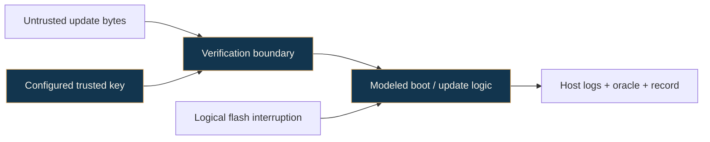

# Threat model

[Project overview](../README.md) · [Visual walkthrough](../WALKTHROUGH.md) · [Documentation map](README.md)

**The lab asks whether a modeled update path accepts authorized images and recovers consistently when update inputs or flash operations are disturbed.** The threat model defines questions; the [matrix](TEST_MATRIX.md) shows which are actually exercised.

## 01 / Assets and invariants

| Asset | Intended invariant | Current evidence |
|---|---|---|
| Signing-key identity | Only images authorized by the selected key are accepted | Host key checks; selected simulator signature tests |
| Firmware integrity | Changes to authenticated bytes are detected | Corpus mutations and runtime bad-secondary tests |
| Version policy | Older signed images obey the configured downgrade rule | V01's upstream refusal assertions; direct corpus observations and an active disabled-policy acceptance control remain gaps |
| Boot metadata | Update state remains consistent across modeled interruption | Fault helper checks images and trailers after completion |
| Recoverability | Interrupted updates converge to the documented safe state | Simulator checks for the selected numeric indices |
| Evidence integrity | A reviewer can tie results to inputs and configuration | JSON/log records, corpus manifest, optional record signatures |

## 02 / Trust boundaries

This is a conceptual boundary diagram. The host `imgtool` lane and simulator lane run separately; the diagram does not imply that a corpus image is transferred into simulator flash.

## 03 / Attacker capabilities

Within the lab model, an attacker can supply malformed or modified image bytes, submit an image signed by a different key, and trigger logical interruption around modeled flash operations. Selected tests also construct invalid secondary-slot state.

The baseline assumes the attacker cannot replace the trusted bootloader, change its configured trust anchor, or obtain an authorized private signing key. Arbitrary writes to every device region are not exhaustively modeled; each scenario defines the bytes and operations under test.

The host harness, compiler, simulator, signing tools, and local filesystem must be trusted for the recorded experiment. They are outside the device trust boundary but inside the experiment's trust assumptions.

## 04 / Outside this model

Physical glitching, invasive attacks, side channels, production provisioning, transport authentication, and malicious build infrastructure are not tested. Secure counters and device key revocation also require additional runtime work.

See [limitations](LIMITATIONS.md) before translating a passing lab case into a product security claim.
