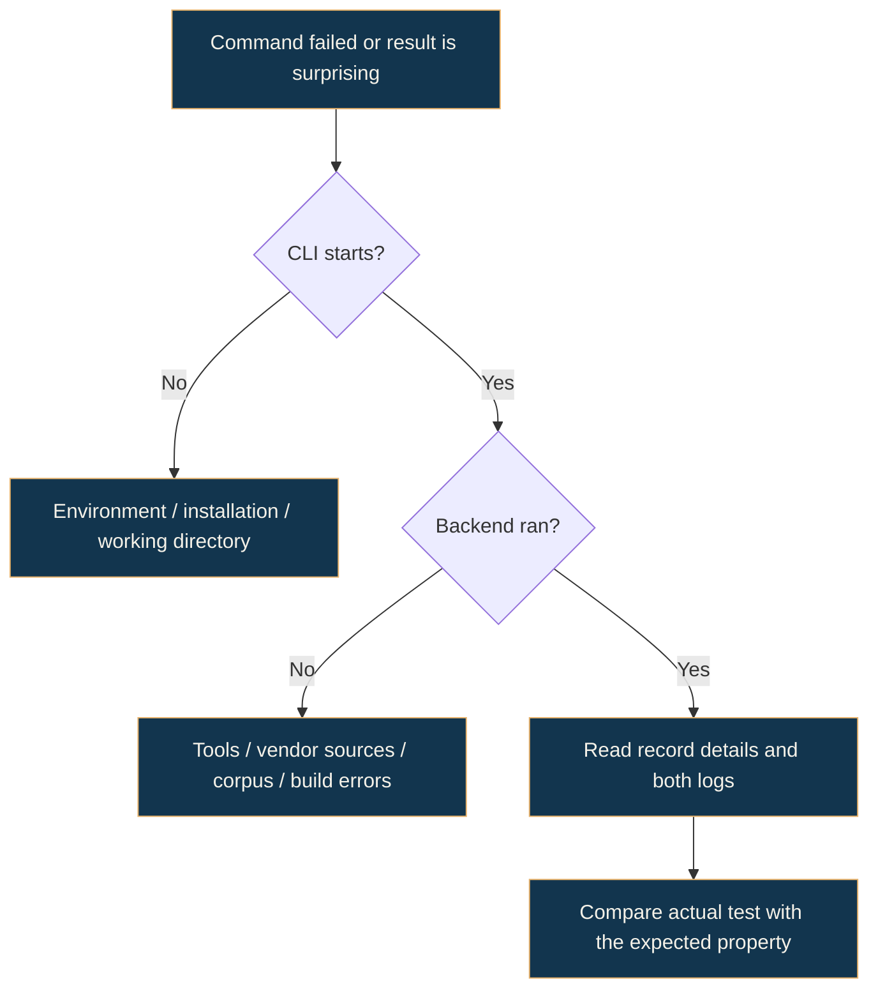

# Troubleshooting a BootLab run

[Project overview](../README.md) · [Visual walkthrough](../WALKTHROUGH.md) · [Documentation map](README.md)

**Start with the layer that failed: setup, backend execution, oracle interpretation, or evidence presentation.** Scenario runs use unique run IDs, so a new run does not overwrite older records.

## 01 / Locate the problem



## 02 / Environment and input problems

Commands below assume the `BootLab/` directory.

| Symptom | Likely cause | Next action |
|---|---|---|
| `bootlab: command not found` | Virtual environment inactive or package not installed | Activate `.venv/bin/activate`; install with `python -m pip install -e ".[dev]"` |
| No scenarios found | Wrong workspace or scenario directory | Check `pwd` and use the project root; `--workspace` is a global CLI option before the subcommand |
| `Image not found` | Corpus missing or wrong filename in the case | Run `bootlab build-corpus`; compare `backend_args.image` with the manifest |
| `imgtool` missing | Vendored signing tool not installed in this environment | Run `python -m pip install ./vendor/mcuboot/scripts` |
| `cargo` missing / native build failure | Rust or C build prerequisites unavailable | Check versions and compiler output; use [the toolchain guide](TOOLCHAIN.md) or [Docker](DOCKER.md) |
| Missing vendored files | Incomplete source checkout/archive | For a Git checkout, initialize dependencies with `git submodule update --init --recursive`; otherwise obtain the complete source tree |
| `mcuboot_commit: unknown` | Vendor Git metadata absent | Retain the source revision and local patch separately; do not invent a commit value |
| Baseline fails because `FAULT_INDEX` is absent | Unfiltered Cargo tests include the local fault fixture | Use `FAULT_INDEX=0 bootlab baseline` for a no-cut fixture input |

Check the installed CLI without running experiments:

```bash
bootlab --help
bootlab run-matrix --help
bootlab fault-sweep --help
bootlab fuzz-image --help
```

`fuzz-image` accepts `--iterations`, not `--max-runs`. The [reproducibility guide](REPRODUCIBILITY.md) contains the full setup sequence.

## 03 / A result passed, but the claim looks wrong

| Observation | Explanation | Inspect |
|---|---|---|
| Rejection case reports `ERROR` | Traceback, invocation issue, timeout, or ambiguous verifier output is not a clean rejection | `stderr_path` in the run record and [findings policy](FINDINGS_POLICY.md) |
| Different IDs produce similar simulator output | Several cases use the same Cargo filter | `backend_args.cargo_test` and the upstream test body |
| Overwrite baseline passes without an obvious upgrade | Some revert helpers return early in overwrite mode | P01O/P02O notes in [the matrix](TEST_MATRIX.md) |
| V02 reports `SKIP` | The pinned feature-disabled helper returns early and does not observe acceptance | Effective features and declared intent in V01/V02 records |
| Fault index zero produces no reset | Counter decrements before comparison, so zero does not trigger a cut | [Counter explanation](FAULT_INJECTION.md#02--counter-behavior) |
| Positive fault index is not counted | Current simulator output does not emit an explicit reached marker | Fault record outcome and raw test output |
| Profile says swap, command says overwrite | The adapter executes `backend_args`, not the full profile file | V01/V02 effective Cargo features |
| “Rotation” case has no device activity | K01–K03 select one host verification key | [Key-case scope](../WALKTHROUGH.md#key-cases) |

Do not fix a surprising result by weakening its expectation. First establish which input, test body, and assertion actually ran.

## 04 / Fault sweep output is incomplete

The Python adapter normally runs Cargo without `--nocapture`. Successful Rust tests may therefore hide `FAULT_PROBE` or `FAULT_RESULT` lines from its parser. This can leave the automatic operation-count probe without a usable count or a sweep row without a descriptive note.

Use an explicit bounded range:

```bash
bootlab fault-sweep --start 0 --end 10 --features sig-ecdsa
```

This checks 11 indices. For human inspection of probe output, use the exact direct-Cargo command in [the extension guide](FAULT_INJECTION.md#03--reproduce-the-extension-directly). Counts can differ between modeled devices; they are not semantic sector/trailer labels.

## 05 / Evidence and presentation problems

| Symptom | Explanation / next action |
|---|---|
| Single case ran but matrix report is unchanged | `run-scenario` writes that case's files; `run-matrix` generates the aggregate report |
| Old and new results appear together | Generators can read existing records from earlier runs; retain or separate runs deliberately |
| Comparison command exits with failure | At least one selected case failed or was skipped; read its comparison table |
| Record signature no longer verifies | Check whether a rerun or edit changed the JSON, whether the signature exists, and whether the local signer key matches |
| Container results disappeared | A `--rm` container needs an evidence bind mount for host retention; see [Docker](DOCKER.md#03--keep-results-on-the-host) |
| PNG/GIF missing | Install Pillow in the rendering environment and run `./scripts/generate-animations.sh` |
| README does not switch theme/motion | The viewer may not preserve `<picture>` media queries; use explicit still-image links or the local gallery |
| Animation text is small on a phone | Open the linked full-size still; the header also has a dedicated narrow layout |

## 06 / Prepare a useful issue or investigation note

Include the exact command and working directory, scenario ID, effective backend arguments, tool versions, vendor revision/local patch, and the relevant record and logs. For malformed-image cases, preserve the exact reproducer bytes and their hash. Describe expected and observed behavior separately, and state whether the observation came from `imgtool`, the simulator, or a physical board.

Use [the findings policy](FINDINGS_POLICY.md) to classify the observation and [the retention checklist](REPRODUCIBILITY.md#04--retain-a-reviewable-run) to keep the experiment reviewable.
